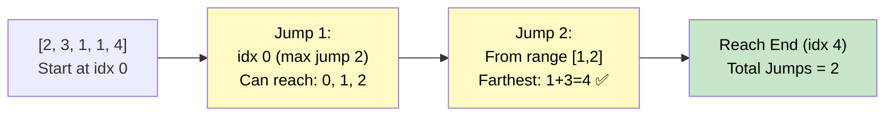

# 🚶‍♂️ Walkthrough: Minimum Jumps to Reach the End

## 👶 Explain Like I'm 5
You're on an array. Each number tells you the **maximum** number of steps you can jump forward from that position. You want to reach the **last index** in the **fewest jumps**.

Think of it like BFS on a graph — each "level" represents one jump. You expand as far as you can in each level.

## 🎯 Core Strategy
**Greedy BFS** with two pointers.

- `curr_end`: the farthest index reachable with the current number of jumps.
- `farthest`: the farthest index ever seen so far.
- `jumps`: count of jumps taken.

Loop from `i = 0` to `n-2`:
1. Update `farthest = max(farthest, i + nums[i])`.
2. When `i == curr_end`, we've exhausted the current jump's reach. Increment `jumps`, update `curr_end = farthest`.
3. Early exit if `curr_end >= n-1`.

## 🏃‍♂️ Step-by-Step Execution (Dry Run)
**Input**: `[2, 3, 1, 1, 4]`

| i | nums[i] | farthest | curr_end | jumps |
|---|---|---|---|---|
| 0 | 2 | max(0,0+2)=2 | ==curr_end(0)! → jumps=1, curr_end=2 | 1 |
| 1 | 3 | max(2,1+3)=4 | — | 1 |
| 2 | 1 | max(4,2+1)=4 | ==curr_end(2)! → jumps=2, curr_end=4 | 2 |
| | | | curr_end(4) >= n-1(4)! Break | |

**Return `2`** ✅

## 📊 Visual Diagram

## 🛑 Complexity
- **Time:** $O(N)$.
- **Space:** $O(1)$.
- **Single element:** Return `0` immediately (already at end).
