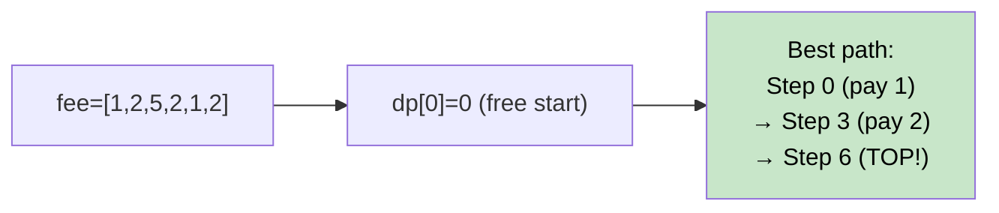

# 🚶‍♂️ Walkthrough: Minimum Jumps with Fee

## 👶 Explain Like I'm 5
You have a staircase of `N` steps. Each step has a cost (fee). You can take **1, 2, or 3 steps** at a time. Find the minimum total fee to reach the top (step `N`, which is beyond all the steps).

Think of it like choosing the cheapest path up a staircase where some steps are more expensive.

## 🎯 Core Strategy
**1D Fibonacci-style DP**.

`dp[i]` = minimum cost to **land on** step `i`.

- `dp[0] = 0` (ground floor, free — you start here, not pay here).
- For `i` from `1` to `N`:
  - `take1 = dp[i-1] + fee[i-1]` (jump 1 from step `i-1`)
  - `take2 = dp[i-2] + fee[i-2]` if `i >= 2` (jump 2 from step `i-2`)
  - `take3 = dp[i-3] + fee[i-3]` if `i >= 3` (jump 3 from step `i-3`)
  - `dp[i] = min(take1, take2, take3)`
- Return `dp[N]`.

**Why `fee[i-1]`?** When you're at position `i-1` (0-indexed step), you pay `fee[i-1]` to leave that step. `dp[i]` represents arriving at step `i`.

## 🏃‍♂️ Step-by-Step Execution (Dry Run)
**Input**: `fee = [1, 2, 5, 2, 1, 2]` → `N = 6`

| i | take1 | take2 | take3 | dp[i] |
|---|---|---|---|---|
| 0 | — | — | — | 0 |
| 1 | dp[0]+fee[0] = 1 | inf | inf | 1 |
| 2 | dp[1]+fee[1] = 3 | dp[0]+fee[0] = 1 | inf | **1** |
| 3 | dp[2]+fee[2] = 6 | dp[1]+fee[1] = 3 | dp[0]+fee[0] = 1 | **1** (jump 3 from step 0!) |
| 4 | dp[3]+fee[3] = 3 | dp[2]+fee[2] = 6 | dp[1]+fee[1] = 3 | **3** |
| 5 | dp[4]+fee[4] = 4 | dp[3]+fee[3] = 3 | dp[2]+fee[2] = 6 | **3** |
| 6 | dp[5]+fee[5] = 5 | dp[4]+fee[4] = 4 | dp[3]+fee[3] = 3 | **3** |

**Return `dp[6] = 3`** ✅ (Path: step 0 → step 3 → step 6, paying fees 1+2=3)

## 📊 Visual Diagram

## 🛑 Complexity
- **Time:** $O(N)$.
- **Space:** $O(N)$ (can be reduced to $O(3)$ with rolling vars).
