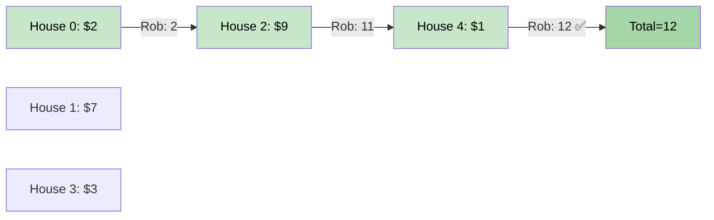

# 🚶‍♂️ Walkthrough: House Thief (House Robber)

## 👶 Explain Like I'm 5
You're a burglar. You can rob any house, but **NOT two adjacent houses** (the alarm will go off and you'll get caught).

At each house, you have two choices:
1. **Rob this house** — you get the money here, but you must skip the house next door. Your total comes from this house + what you could rob up to 2 houses ago.
2. **Skip this house** — move on, and carry over the best total from the previous house.

This is a classic **Fibonacci-style DP** decision at every step!

## 🎯 Core Strategy
**Fibonacci DP** with the recurrence:

`dp[i] = max(dp[i-1], dp[i-2] + nums[i])`

- `dp[i-1]`: Skip house `i`, take the best from `i-1`.
- `dp[i-2] + nums[i]`: Rob house `i`, add to the best from `i-2` (skipping `i-1`).

**Space Optimized**: Only keep `prev2` and `prev1` instead of the full array.

1. Base: `prev2 = nums[0]`, `prev1 = max(nums[0], nums[1])`.
2. Loop from `i = 2` to `len(nums)-1`: `curr = max(prev1, prev2 + nums[i])`.
3. Update: `prev2, prev1 = prev1, curr`.
4. Return `prev1`.

## 🏃‍♂️ Step-by-Step Execution (Dry Run)
**Input**: `[2, 7, 9, 3, 1]`

| i | nums[i] | prev2 | prev1 | curr |
|---|---|---|---|---|
| Base | — | 2 | 7 | — |
| 2 | 9 | 7 | max(7, 2+9)=11 | 11 |
| 3 | 3 | 11 | max(11, 7+3)=11 | 11 |
| 4 | 1 | 11 | max(11, 11+1)=12 | 12 |

**Return `prev1 = 12`** ✅ (Rob houses 0, 2, 4: 2+9+1=12)

## 📊 Visual Diagram

## 🛑 Complexity
- **Time:** $O(N)$.
- **Space:** $O(1)$ — two rolling variables.

### Edge Cases
- **Empty array:** Return `0`.
- **Single house:** Return `nums[0]`.
- **Two houses:** Return `max(nums[0], nums[1])`.
