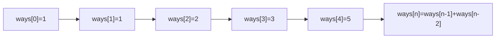
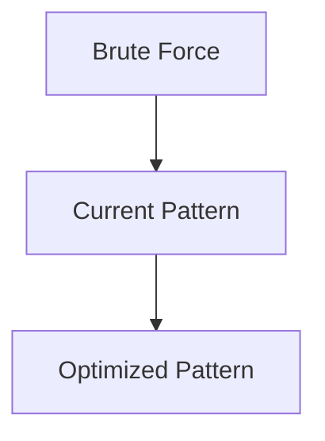

# Pattern 23: Fibonacci Numbers (Dynamic Programming)

## 👶 Explain Like I'm 5

You're climbing stairs. You can take 1 or 2 steps at a time.
How many DIFFERENT ways can you reach step 10?
You realize: the answer for step 10 = ways to step 9 + ways to step 8.
Because from step 9 you take 1 step, and from step 8 you take 2 steps.
So instead of trying EVERY path, you just build a table:
  ways[1]=1, ways[2]=2, ways[3]=ways[2]+ways[1]=3, ...

That's the Fibonacci DP pattern: **the answer to a problem is the sum of the
answers to the previous two (or more) subproblems.**

---

## 🧩 Core Idea & Pattern Detection

The "Fibonacci Numbers" DP pattern covers all problems where the recurrence
has the form:
```
f(n) = f(n-1) + f(n-2) + ... + f(n-k)
```
with some initial base cases.

### When to use it:
- Counting paths/ways from position 0 to position n with bounded jump sizes.
- Maximizing/minimizing cost where each position depends on a small number of previous positions.
- Keywords: "number of ways", "climb stairs", "jump game", "minimum cost".

---

## 🔧 Algorithmic Anatomy

### Space-Optimized Approach (Rolling Variables)

Instead of an O(N) array, keep only the last k values:
```python
prev2, prev1 = f(0), f(1)
for i in range(2, n+1):
    curr = prev1 + prev2
    prev2, prev1 = prev1, curr
return prev1
```

### Mermaid: Staircase Example



---

## ⏱️ Complexity Analysis

| Aspect | Complexity | Why |
|--------|-----------|-----|
| **Time** | O(N) | One pass building up from base cases |
| **Space** | O(1) | Rolling 2-variable approach |

---

## ✅ Problems in This Pattern

| # | Problem | Difficulty |
|---|---------|------------|
| 1 | Fibonacci Numbers | Easy |
| 2 | Staircase (Climb Stairs) | Easy |
| 3 | Number Factors (Count Ways) | Medium |
| 4 | Minimum Jumps to Reach End | Medium |
| 5 | Minimum Jumps with Fee | Medium |
| 6 | House Thief (House Robber) | Medium |


## 📦 Prerequisite Data Structures
- Basic understanding of Arrays, Hash Maps, and Fibonacci Numbers (DP) fundamentals.


## 🔍 How to Spot This Pattern (Signal Detection)
- **Keywords**: "minimize", "maximize", "combinations", "shortest", "longest".
- **Problem Constraints**: Indicates whether O(N), O(N log N), or O(2^N) is acceptable.


## 🏗️ Template / Boilerplate Code
```python
def solve_fibonacci_numbers_dp(nums):
    # Initialize state
    result = 0
    for num in nums:
        # Process num
        pass
    return result
```


## 🔄 Brute Force → Optimal Evolution
- **Brute Force**: Try all possibilities (often O(N^2) or O(2^N)).
- **Optimal**: Use this pattern to reduce redundant work to O(N) or O(N log N).


## 🔗 Pattern Connections



## ⚠️ Common Mistakes & Pitfalls
- Off-by-one errors in loop boundaries.
- Not handling negative numbers or zero correctly.
- Forgetting to update the result variable inside the loop.


## 🎤 Interview Communication Guide
1. **Acknowledge**: "This looks like a variation of the classic problem..."
2. **Propose**: "I'll use this pattern because it optimizes the brute force O(N^2) to O(N)."
3. **Execute**: Write clean, modular code.
4. **Review**: Trace with the provided edge case.


## 🧪 Self-Test Questions
<details>
<summary>When should you use this pattern?</summary>
When the problem asks for optimal subarrays, combinations, or specific mathematical properties.
</details>
<details>
<summary>What is the typical time complexity?</summary>
Usually O(N) or O(N log N), depending on sorting or data structure overhead.
</details>
