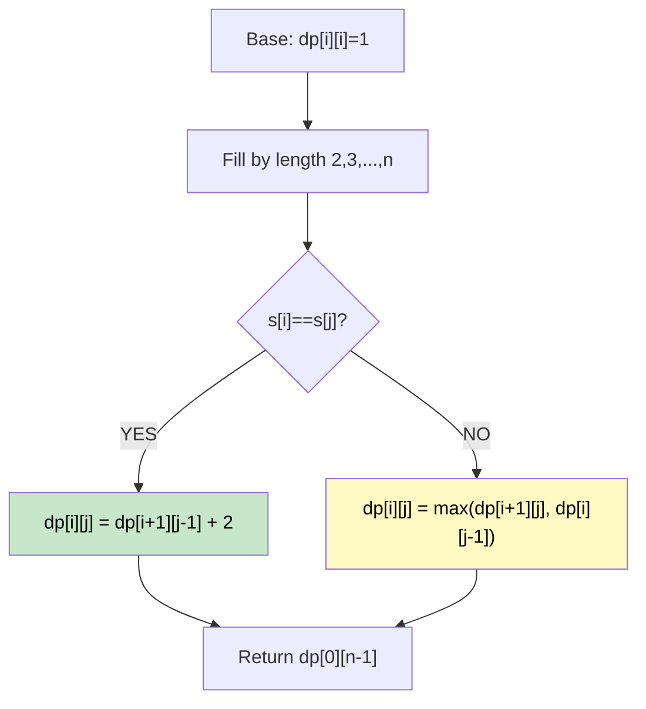

# 🚶‍♂️ Walkthrough: Longest Palindromic Subsequence (LPS)

## 👶 Explain Like I'm 5
A **subsequence** doesn't have to be contiguous — you can skip letters.
Given `"bbbab"`, the longest palindromic subsequence is `"bbbb"` (skip the `a`) with length 4.

How do we find it? We use interval DP — we build up solutions for small substrings and combine them into larger ones.

## 🎯 Core Strategy
**Interval DP** — `dp[i][j]` = LPS length in substring `s[i..j]`.

**Recurrence**:
- `s[i] == s[j]`: The two characters can extend the inner palindrome. `dp[i][j] = dp[i+1][j-1] + 2`.
- `s[i] != s[j]`: We must skip one of them. `dp[i][j] = max(dp[i+1][j], dp[i][j-1])`.

**Base case**: `dp[i][i] = 1` (single character is a palindrome of length 1).

**Filling order**: We must fill by increasing **substring length** (from length 2 up to `n`). This ensures the smaller subproblems are ready before we need them.

## 🏃‍♂️ Step-by-Step Execution (Dry Run)
**Input**: `"bbbab"` (n=5)

The final `dp` table (`dp[0][4]` = answer):

```
    b   b   b   a   b
b [ 1   2   3   3   4 ]
b [ 0   1   2   2   3 ]
b [ 0   0   1   1   3 ]
a [ 0   0   0   1   1 ]
b [ 0   0   0   0   1 ]
```
`dp[0][4] = 4` ✅

## 📊 Visual Diagram



## 🛑 Complexity
- **Time:** $O(N^2)$.
- **Space:** $O(N^2)$ for the DP table.
