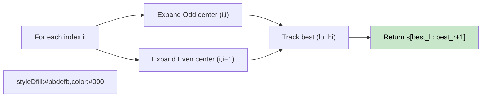

# 🚶‍♂️ Walkthrough: Longest Palindromic Substring

## 👶 Explain Like I'm 5
A **substring** is a contiguous piece of the string (no skipping!).
Find the longest contiguous piece that reads the same forwards and backwards.

The key trick: every palindrome has a **center**. Either it's a single character (odd length: `"aba"`) or two identical characters (even length: `"abba"`). For each possible center, we **expand outward** as long as the characters match.

## 🎯 Core Strategy
**Expand Around Center** — $O(N^2)$ time, $O(1)$ space.

For every index `i`:
1. **Odd-length**: Start expanding with `lo = i, hi = i`. While `s[lo] == s[hi]`, expand outward.
2. **Even-length**: Start expanding with `lo = i, hi = i+1`. While `s[lo] == s[hi]`, expand outward.
3. Track the best `(lo, hi)` found.

Return `s[best_l : best_r + 1]`.

## 🏃‍♂️ Step-by-Step Execution (Dry Run)
**Input**: `"cbbd"`

| Center | Type | Start | Expand | Best |
|---|---|---|---|---|
| `c` (0) | Odd | (0,0)=`c` | No expansion | `c`, len=1 |
| `b` (1) | Odd | (1,1)=`b` | No expansion | `c`, len=1 |
| `b,b` (1,2) | Even | (1,2)=`b,b` | Match! Expand → (0,3)=`c,d` No match | `bb`, len=2 ✅ |
| `b` (2) | Odd | (2,2) | same | `bb` wins |
| `d` (3) | Odd | (3,3) | — | `bb` wins |

**Return `"bb"`** ✅

## 📊 Visual Diagram

## 🛑 Complexity
- **Time:** $O(N^2)$ — $2N$ centers, each expands up to $O(N)$.
- **Space:** $O(1)$ — just two index variables.
