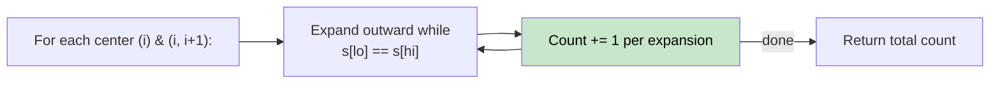

# 🚶‍♂️ Walkthrough: Count of Palindromic Substrings

## 👶 Explain Like I'm 5
Count **every** palindromic substring in the string (not just the longest).
`"aaa"` contains: `"a"` (idx 0), `"a"` (idx 1), `"a"` (idx 2), `"aa"` (idx 0-1), `"aa"` (idx 1-2), `"aaa"` → 6 palindromes.

## 🎯 Core Strategy
Same **Expand Around Center** technique as the previous problem, but instead of tracking the best, we **increment a counter for every valid expansion**.

For each center, every successful expansion `(lo--, hi++)` means we found a new palindromic substring. We count it immediately.

```python
def expand(lo, hi):
    while lo >= 0 and hi < len(s) and s[lo] == s[hi]:
        count += 1   # Found palindrome s[lo..hi]!
        lo -= 1
        hi += 1
```

## 🏃‍♂️ Step-by-Step Execution (Dry Run)
**Input**: `"aba"`

| Center | Type | Expansion | count |
|---|---|---|---|
| `a` (0) | Odd | `(0,0)` → count=1. Expand to `(-1,1)` → stop | 1 |
| `b` (1) | Odd | `(1,1)` → count=2. Expand to `(0,2)` `a==a` → count=3. Expand to `(-1,3)` → stop | 3 |
| `a` (1,2) | Even | `(1,2)` `b≠a` → stop | 3 |
| `a` (2) | Odd | `(2,2)` → count=4. Expand to `(1,3)` → stop | 4 |

**Return `4`** ✅ (palindromes: `a`, `b`, `a`, `aba`)

## 📊 Visual Diagram



## 🛑 Complexity
- **Time:** $O(N^2)$.
- **Space:** $O(1)$.
