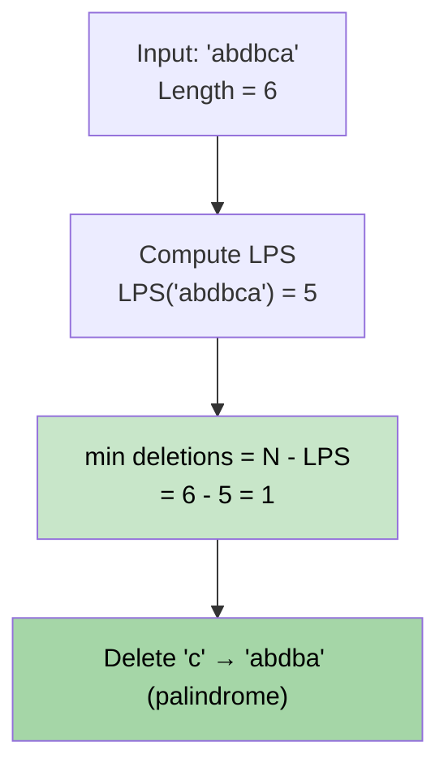

# 🚶‍♂️ Walkthrough: Minimum Deletions to Make a String Palindrome

## 👶 Explain Like I'm 5
What is the fewest number of characters you must DELETE from a string to make it a palindrome?

**Key Insight**: The characters that STAY must form a palindromic subsequence. So the best we can do is keep the **Longest Palindromic Subsequence (LPS)** and delete everything else!

`min_deletions = len(s) - LPS(s)`

## 🎯 Core Strategy
1. **Compute LPS**: Use the same interval DP from Problem 01.
2. **Return** `n - LPS`.

This is a beautiful reduction — an $O(N^2)$ problem becomes just a few extra lines on top of LPS.

## 🏃‍♂️ Example
**Input**: `"abdbca"` (n=6)

LPS of `"abdbca"` = `"abdba"` or `"abcba"` (length 5).

`min_deletions = 6 - 5 = 1`. Delete the `c`!

**Return `1`** ✅

## 📊 Visual Diagram

## 🛑 Complexity
- **Time:** $O(N^2)$ — same as LPS.
- **Space:** $O(N^2)$ — same DP table.

### Edge Cases
- **Already a palindrome `"aa"`:** LPS = 2 = `n`. Deletions = 0.
- **All different `"pqr"`:** LPS = 1. Deletions = `3 - 1 = 2`.
