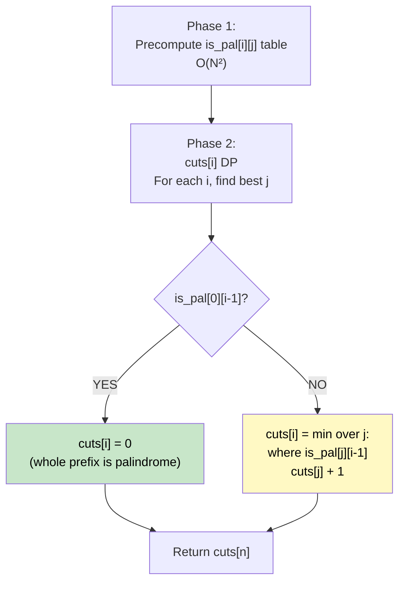

# 🚶‍♂️ Walkthrough: Palindromic Partitioning (Minimum Cuts)

## 👶 Explain Like I'm 5
Cut a string into pieces so that **each piece is a palindrome**. Find the **minimum number of cuts** to do this.
Example: `"aab"` → `"aa" | "b"` → **1 cut**.

Brute force would try all possible splits. Instead, we use DP + a precomputed palindrome lookup table.

## 🎯 Core Strategy
Two-phase DP.

### Phase 1: Precompute Palindrome Table
`is_pal[i][j]` = True if `s[i..j]` is a palindrome.
- A substring `s[i..j]` is a palindrome if `s[i] == s[j]` AND either `j - i <= 2` (short, trivially a palindrome) OR `is_pal[i+1][j-1]` is True.

### Phase 2: Minimum Cuts DP
`cuts[i]` = minimum cuts for `s[0..i-1]` (first `i` characters).

- `cuts[0] = -1` (sentinel — empty prefix, 0 cuts with -1 as base).
- For each `i` from 1 to `n`:
  - If `s[0..i-1]` is a palindrome: `cuts[i] = 0` (no cuts needed!).
  - Else: `cuts[i] = min(cuts[j] + 1)` for all `j` where `s[j..i-1]` is a palindrome.

**Return** `cuts[n]`.

## 🏃‍♂️ Step-by-Step Execution (Dry Run)
**Input**: `"aab"` (n=3)

### Phase 1: is_pal table
```
     a    a    b
a  [ T    T    F ]
a  [ -    T    F ]
b  [ -    -    T ]
```

### Phase 2: cuts DP
- `cuts[0] = -1` (sentinel)
- `i=1`: `s[0..0]`=`"a"` is_pal → `cuts[1] = 0`
- `i=2`: `s[0..1]`=`"aa"` is_pal → `cuts[2] = 0`
- `i=3`: `s[0..2]`=`"aab"` NOT pal.
  - `j=1`: `s[1..2]`=`"ab"` NOT pal → skip.
  - `j=2`: `s[2..2]`=`"b"` IS pal → `cuts[2] + 1 = 1`.
  - `cuts[3] = 1` ✅

**Return `cuts[3] = 1`** ✅

## 📊 Visual Diagram



## 🛑 Edge Cases & Complexity
- **Time:** $O(N^2)$ — palindrome precomputation + cuts DP (with `min()` over all `j`).
- **Space:** $O(N^2)$ — palindrome table.
- **Single char or already palindrome:** Phase 2 immediately sets `cuts[i] = 0`. Returns `0`.
