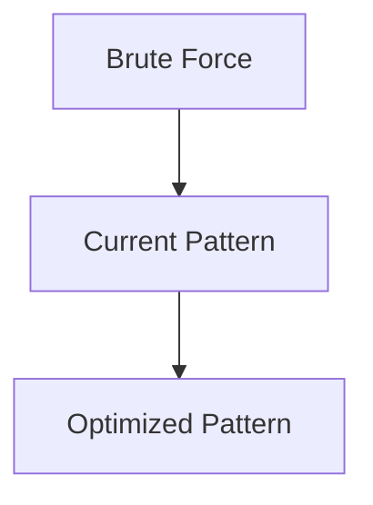

# Pattern 24: Palindromic Subsequence (Dynamic Programming)

## 👶 Explain Like I'm 5

Think of palindromes like a mirror: "racecar" reads the same from both sides.
Now the tricky question: what's the LONGEST subsequence (letters you can pick,
not necessarily adjacent) from a word that forms a palindrome?
"bbbab" → "bbbb" is the longest palindromic subsequence (length 4).

The key insight: expand from the outside in. Compare the first and last character.
If they match → both can be part of our palindrome → add 2 to whatever is in the middle.
If they don't match → take the best of (ignore first) or (ignore last).
**This builds a 2D DP table where dp[i][j] = LPS length for substring s[i..j].**

---

## 🧩 Core Idea & Pattern Detection

The **interval DP** template: solve small substrings first, build up to the full string.
```
dp[i][j] = LPS of s[i..j]
if s[i] == s[j]: dp[i][j] = dp[i+1][j-1] + 2
else:            dp[i][j] = max(dp[i+1][j], dp[i][j-1])
```

### When to use it:
- Questions about palindromic subsequences, substrings, counts in a string.
- Any problem requiring you to compare the string against its reverse.

---

## ⏱️ Complexity Analysis

| Aspect | Complexity |
|--------|-----------|
| **Time** | O(N²) |
| **Space** | O(N²) or O(N) with rolling rows |

---

## ✅ Problems in This Pattern

| # | Problem | Difficulty | LeetCode |
|---|---------|------------|----------|
| 1 | Longest Palindromic Subsequence | Medium | #516 |
| 2 | Longest Palindromic Substring | Medium | #5 |
| 3 | Count of Palindromic Substrings | Medium | #647 |
| 4 | Minimum Deletions to Make a Palindrome | Medium | #1312 variant |
| 5 | Palindromic Partitioning (Min Cuts) | Hard | #132 |


## 📦 Prerequisite Data Structures
- Basic understanding of Arrays, Hash Maps, and Palindromic Subsequence (DP) fundamentals.


## 🔍 How to Spot This Pattern (Signal Detection)
- **Keywords**: "minimize", "maximize", "combinations", "shortest", "longest".
- **Problem Constraints**: Indicates whether O(N), O(N log N), or O(2^N) is acceptable.


## 🔧 Algorithmic Anatomy
### Variable Table
| Variable | Purpose |
|---|---|
| `result` | Stores the final answer |
| `visited` | Tracks seen elements to avoid cycles or re-processing |

### Step-by-Step Recipe
1. Initialize data structures.
2. Iterate through the input.
3. Update state based on current element.
4. Return result.

### Loop Invariants
- At the start of each iteration, the state reflects the optimal solution up to the previous element.

### DOs and DON'Ts
- **DO**: Trace through an example manually before coding.
- **DON'T**: Forget edge cases like empty inputs.


## 🏗️ Template / Boilerplate Code
```python
def solve_palindromic_subsequence_dp(nums):
    # Initialize state
    result = 0
    for num in nums:
        # Process num
        pass
    return result
```


## 🔄 Brute Force → Optimal Evolution
- **Brute Force**: Try all possibilities (often O(N^2) or O(2^N)).
- **Optimal**: Use this pattern to reduce redundant work to O(N) or O(N log N).


## 🔗 Pattern Connections



## ⚠️ Common Mistakes & Pitfalls
- Off-by-one errors in loop boundaries.
- Not handling negative numbers or zero correctly.
- Forgetting to update the result variable inside the loop.


## 🎤 Interview Communication Guide
1. **Acknowledge**: "This looks like a variation of the classic problem..."
2. **Propose**: "I'll use this pattern because it optimizes the brute force O(N^2) to O(N)."
3. **Execute**: Write clean, modular code.
4. **Review**: Trace with the provided edge case.


## 🧪 Self-Test Questions
<details>
<summary>When should you use this pattern?</summary>
When the problem asks for optimal subarrays, combinations, or specific mathematical properties.
</details>
<details>
<summary>What is the typical time complexity?</summary>
Usually O(N) or O(N log N), depending on sorting or data structure overhead.
</details>
