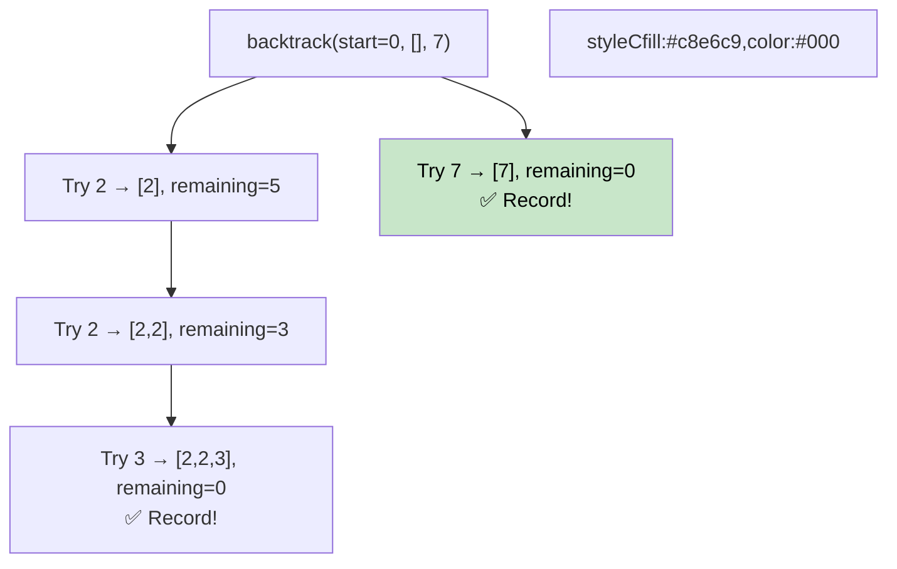

# 🚶‍♂️ Walkthrough: Combination Sum

## 👶 Explain Like I'm 5
Given a list of numbers and a target, find all unique combinations that add up to the target. You can use the same number multiple times.

Think of it like having unlimited coins of different values and wanting to make a specific total. You explore all possibilities — but if a choice leads to a dead end (sum exceeds target), you **back up** and try something else.

## 🎯 Core Strategy
**Backtracking** — try, recurse, undo (backtrack).

1. **Sort candidates**: Enables early pruning — once a candidate exceeds `remaining`, all larger ones will too.
2. **`backtrack(start, current, remaining)`**:
   - **Base case**: `remaining == 0` → record `current` as a valid combination.
   - **Prune**: if `candidates[i] > remaining`, break (no point continuing).
   - For each candidate `c` from `start`:
     - Add `c` to `current`.
     - Recurse with `backtrack(i, current, remaining - c)`. *(Note: `i` not `i+1` allows reuse)*
     - **Backtrack**: remove `c` from `current`.

## 🏃‍♂️ Step-by-Step Execution (Dry Run)
**Input**: `candidates = [2, 3, 6, 7]`, `target = 7`

```
backtrack(0, [], 7)
  try 2 → backtrack(0, [2], 5)
    try 2 → backtrack(0, [2,2], 3)
      try 2 → backtrack(0, [2,2,2], 1)
        try 2 → 2 > 1, BREAK
      try 3 → backtrack(1, [2,2,3], 0) ✅ → Record [2,2,3]
    try 3 → backtrack(1, [2,3], 2)
      try 3 → 3 > 2, BREAK
    try 6 → 6 > 5, BREAK
  try 3 → backtrack(1, [3], 4)
    try 3 → backtrack(1, [3,3], 1) → all > 1, BREAK
    try 6 → 6 > 4, BREAK
  try 6 → backtrack(2, [6], 1) → 6 > 1, BREAK
  try 7 → backtrack(3, [7], 0) ✅ → Record [7]
```

**Result**: `[[2, 2, 3], [7]]` ✅

## 📊 Visual Diagram



## 🛑 Complexity
- **Time:** $O(N^{T/M})$ where $T$ is the target and $M$ is the minimum candidate value.
- **Space:** $O(T/M)$ recursion depth.
