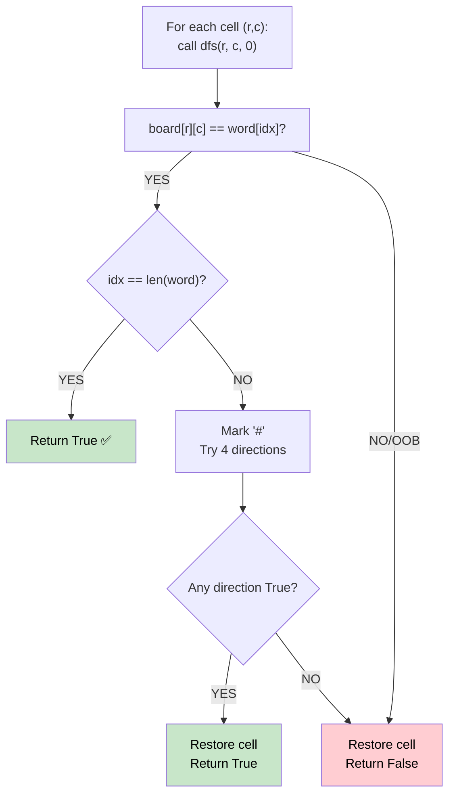

# 🚶‍♂️ Walkthrough: Word Search

## 👶 Explain Like I'm 5
You have a grid of letters. Can you find a given word by tracing a path through adjacent cells (up, down, left, right) without visiting the same cell twice?

At each step, you pick a direction. If the letter matches the next character in the word, continue. If not (or you've gone out of bounds), **backtrack** and try a different direction.

## 🎯 Core Strategy
**DFS Backtracking** on the grid.

1. For every cell `(r, c)`, attempt to start the word search using `dfs(r, c, idx=0)`.
2. **`dfs(r, c, idx)`**:
   - **Base case**: If `idx == len(word)`, we found the whole word → return `True`.
   - **Prune**: Out of bounds, or `board[r][c] != word[idx]` → return `False`.
   - **Mark visited**: Temporarily replace `board[r][c]` with `'#'` to prevent revisiting.
   - **Recurse**: Try all 4 directions with `idx + 1`.
   - **Restore** (backtrack): Put the original character back.
3. Return `True` if any starting cell leads to success.

## 🏃‍♂️ Step-by-Step Execution (Dry Run)
**Input**: `board = [["A","B"],["C","D"]]`, `word = "ABD"`

- Start at `(0,0)` `A` == `A` ✅. Mark `#`.
  - Go Right `(0,1)` `B` == `B` ✅. Mark `#`.
    - Go Down `(1,1)` `D` == `D` ✅. `idx=3 == len("ABD")`. Return `True`! 🎉

## 📊 Visual Diagram

## 🛑 Complexity
- **Time:** $O(N \times M \times 4^L)$ where $N \times M$ is the grid size and $L$ is the word length.
- **Space:** $O(L)$ for recursion depth.
- **Revisit prevention**: Replacing with `'#'` is a clever in-place trick — no extra visited set needed.
