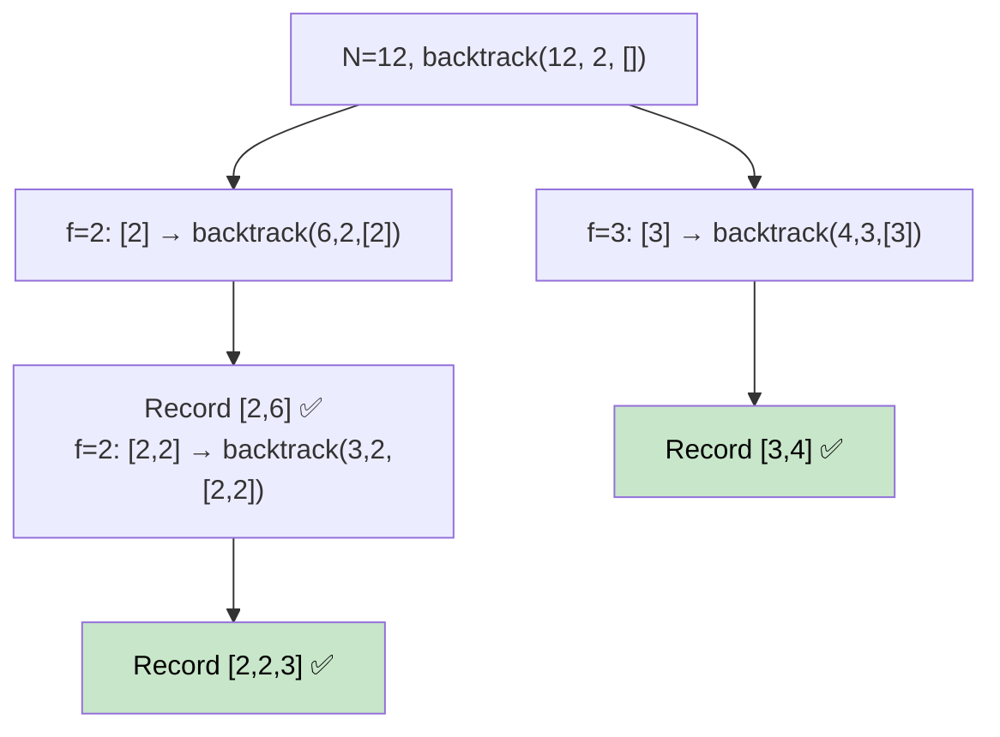

# 🚶‍♂️ Walkthrough: Factor Combinations

## 👶 Explain Like I'm 5
Given `N`, find all ways to express `N` as a product of integers ≥ 2.
`N = 12` → `{2×2×3}`, `{2×6}`, `{3×4}` (but NOT `{1×12}` or `{12}` alone).

Think of it like a tree — you try dividing by each factor, then recurse on the quotient.

## 🎯 Core Strategy
**Backtracking** on factor combinations.

**`backtrack(remaining, start, current)`**:
1. **Record**: If `current` is non-empty, add `current + [remaining]` to results. (This represents using the `remaining` value as the last factor).
2. **Explore**: Try factors `f` from `start` up to `√remaining`. If `remaining % f == 0`:
   - Add `f` to `current`.
   - Recurse with `backtrack(remaining // f, f, current)`.
   - **Backtrack**: pop `f`.

**Key insight**: We record `current + [remaining]` at each recursive call (not just at the base case). This naturally captures all valid factorizations. Starting with `current = []` and we only record when `current` is non-empty (to avoid recording `[12]` as a factorization of 12).

## 🏃‍♂️ Step-by-Step Execution (Dry Run)
**Input**: `N = 12`

```
backtrack(12, 2, [])
  → Record [12]? No, current is empty.
  f=2: 12%2==0
    current=[2] → backtrack(6, 2, [2])
      → Record [2, 6] ✅
      f=2: 6%2==0
        current=[2,2] → backtrack(3, 2, [2,2])
          → Record [2,2,3] ✅
          No f from 2 divides 3 with f*f<=3 (except 2 doesn't divide 3)
      f=3: 3*3>6, stop
    current=[]
  f=3: 12%3==0
    current=[3] → backtrack(4, 3, [3])
      → Record [3,4] ✅
      f=3: 3*3>4, stop
    current=[]
```

**Result**: `[[2, 6], [2, 2, 3], [3, 4]]` ✅

## 📊 Visual Diagram



## 🛑 Complexity
- **Time:** $O(N \log N)$ — the recursion tree is bounded by the number of factor combinations.
- **Space:** $O(\log N)$ — max recursion depth (e.g., for $N = 2^k$).
