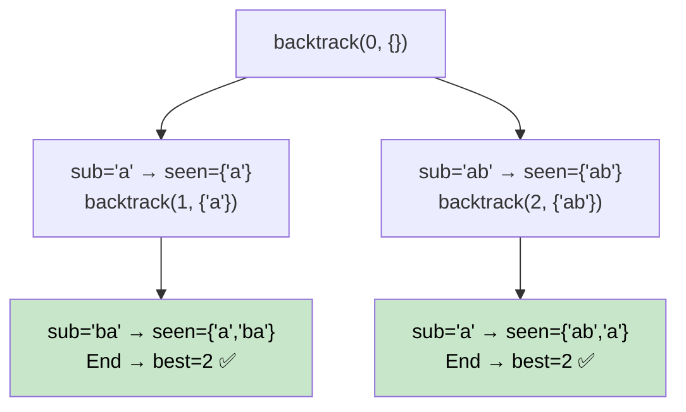

# 🚶‍♂️ Walkthrough: Split String Into Max Unique Substrings

## 👶 Explain Like I'm 5
Split a string into as many **unique** (non-repeating) substrings as possible.
`"ababccc"` → `["a", "b", "ab", "c", "cc"]` → 5 parts.

At each position, try every possible "next piece." If that piece hasn't been used yet, use it and recurse. If it's a repeat, skip it. At the end, update the best count.

## 🎯 Core Strategy
**Backtracking** with a `seen` set.

**`backtrack(start, seen)`**:
1. **Base case**: If `start == len(s)`, update `best` with `len(seen)`.
2. **Explore**: For each `end` from `start+1` to `len(s)+1`:
   - Extract `sub = s[start:end]`.
   - If `sub not in seen`:
     - Add to `seen`.
     - Recurse with `backtrack(end, seen)`.
     - **Backtrack**: remove from `seen`.

## 🏃‍♂️ Step-by-Step Execution (Dry Run)
**Input**: `"aba"`

```
backtrack(0, {})
  end=1: sub="a" → seen={"a"} → backtrack(1, {"a"})
    end=2: sub="b" → seen={"a","b"} → backtrack(2, {"a","b"})
      end=3: sub="a" → "a" in seen! SKIP
      →  dead end, no completion from start=2
    end=3: sub="ba" → seen={"a","ba"} → backtrack(3, {"a","ba"})
      → base case! best = max(0, 2) = 2 ✅
  end=2: sub="ab" → seen={"ab"} → backtrack(2, {"ab"})
    end=3: sub="a" → seen={"ab","a"} → backtrack(3, {"ab","a"})
      → base case! best = max(2, 2) = 2 ✅
```

**Return `2`** ✅

## 📊 Visual Diagram



## 🛑 Complexity
- **Time:** $O(2^N)$ — at each position, we can split or not.
- **Space:** $O(N)$ — `seen` set and recursion depth. Practical because $N \le 16$.
