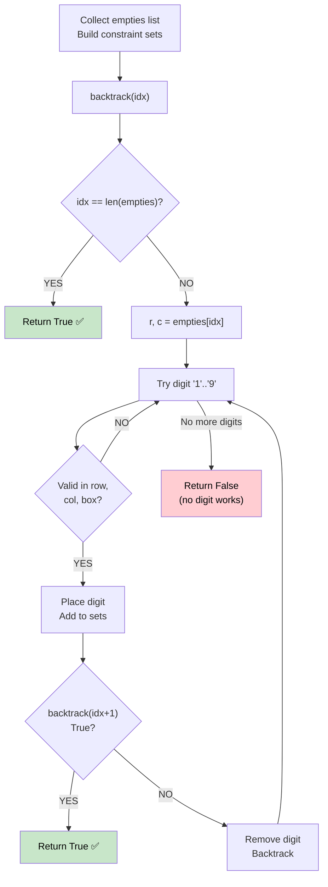

# 🚶‍♂️ Walkthrough: Sudoku Solver

## 👶 Explain Like I'm 5
Fill in a 9×9 Sudoku grid so that each row, each column, and each 3×3 box contains the digits 1–9 exactly once.

Strategy: find an empty cell, try placing digits 1–9. If a digit is valid (not already in that row/column/box), place it and move to the next empty cell. If you get stuck, **erase and backtrack**.

## 🎯 Core Strategy
**Backtracking with Constraint Sets** for maximum pruning speed.

### Setup
1. **Initialize constraint sets**: 9 sets for rows, 9 for columns, 9 for boxes (box index = `(r//3)*3 + c//3`).
2. Pre-populate sets from the given clues.
3. Collect all `empties` (empty cell coordinates) in a list.

### Backtracking
**`backtrack(idx)`** — fills `empties[idx]`:
1. **Base case**: If `idx == len(empties)`, all cells filled → return `True`.
2. Get `r, c, b` for the current empty cell.
3. Try digits `'1'` through `'9'`:
   - **Check**: Is `digit` absent in `rows[r]`, `cols[c]`, and `boxes[b]`?
   - **Place**: Set `board[r][c] = digit` and add to all three sets.
   - **Recurse**: Call `backtrack(idx + 1)`. If it returns `True`, propagate `True` upward.
   - **Backtrack**: Reset `board[r][c] = '.'` and remove from all three sets.
4. If no digit works → return `False`.

## 📊 Visual Diagram

## 🛑 Edge Cases & Complexity
- **Time:** $O(9^{81})$ worst case — in practice, constraint propagation prunes the tree dramatically.
- **Space:** $O(81)$ — 27 constraint sets + recursion stack bounded by empty cell count.
- **Invalid board input**: The algorithm would return `False` without finding a solution (though LeetCode guarantees a unique valid solution).
- **Optimization**: Using sets for constraint checking gives $O(1)$ lookup instead of scanning rows/cols/boxes every time.
