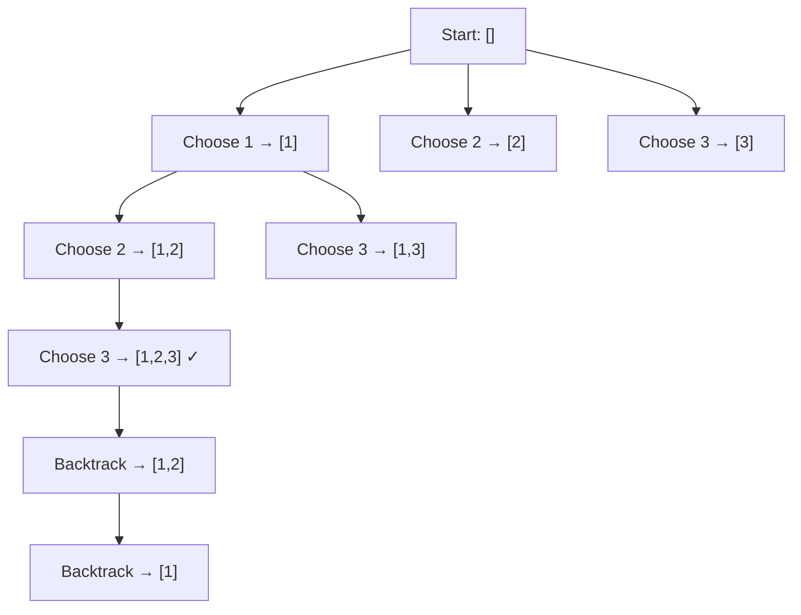
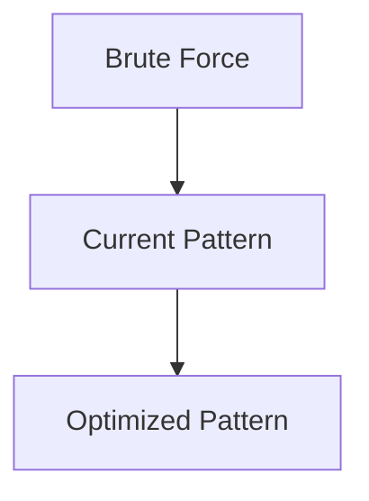

# Pattern 25: Backtracking

## 👶 Explain Like I'm 5

You're in a maze. You walk forward, and whenever you hit a dead end, you
**backtrack** — go back to the last fork in the road and try a different path.
That's backtracking! You systematically explore ALL possible paths, pruning
dead ends early.
It's like solving a Sudoku puzzle: try a number, check if it's valid, go to
the next cell. If you get stuck, erase and try the next number.

---

## 🧩 Core Idea & Pattern Detection

**Backtracking = Recursive exploration + Undo (backtrack)**

The key template:
```python
def backtrack(state, choices):
    if is_solution(state):
        result.append(copy_of(state))
        return
    for choice in choices:
        if is_valid(choice, state):
            make_choice(state, choice)    # Choose
            backtrack(state, next_choices) # Explore
            undo_choice(state, choice)    # Un-choose (BACKTRACK)
```

### When to use it:
- Generate ALL possible solutions (permutations, combinations, subsets).
- Find ONE valid solution (Sudoku, N-Queens).
- Search-space has structure where invalid branches can be pruned early.
- Keywords: "all combinations", "all permutations", "generate all", "find all paths".

---

## 🔧 Visual Anatomy



---

## ⏱️ Complexity Analysis

| Problem | Time | Space |
|---------|------|-------|
| Combination Sum | O(N^(T/min)) | O(T/min) recursion depth |
| Word Search | O(N*M*4^L) | O(L) stack |
| Permutations | O(N!) | O(N) stack |
| Sudoku Solver | O(9^81) worst, much better with pruning | O(81) |

---

## ✅ Problems in This Pattern

| # | Problem | Difficulty | LeetCode |
|---|---------|------------|----------|
| 1 | Combination Sum | Medium | #39 |
| 2 | Word Search | Medium | #79 |
| 3 | Factor Combinations | Medium | #254 |
| 4 | Split String Into Max Unique Substrings | Medium | #1593 |
| 5 | Sudoku Solver | Hard | #37 |


## 📦 Prerequisite Data Structures
- Basic understanding of Arrays, Hash Maps, and Backtracking fundamentals.


## 🔍 How to Spot This Pattern (Signal Detection)
- **Keywords**: "minimize", "maximize", "combinations", "shortest", "longest".
- **Problem Constraints**: Indicates whether O(N), O(N log N), or O(2^N) is acceptable.


## 🔧 Algorithmic Anatomy
### Variable Table
| Variable | Purpose |
|---|---|
| `result` | Stores the final answer |
| `visited` | Tracks seen elements to avoid cycles or re-processing |

### Step-by-Step Recipe
1. Initialize data structures.
2. Iterate through the input.
3. Update state based on current element.
4. Return result.

### Loop Invariants
- At the start of each iteration, the state reflects the optimal solution up to the previous element.

### DOs and DON'Ts
- **DO**: Trace through an example manually before coding.
- **DON'T**: Forget edge cases like empty inputs.


## 🏗️ Template / Boilerplate Code
```python
def solve_backtracking(nums):
    # Initialize state
    result = 0
    for num in nums:
        # Process num
        pass
    return result
```


## 🔄 Brute Force → Optimal Evolution
- **Brute Force**: Try all possibilities (often O(N^2) or O(2^N)).
- **Optimal**: Use this pattern to reduce redundant work to O(N) or O(N log N).


## 🔗 Pattern Connections



## ⚠️ Common Mistakes & Pitfalls
- Off-by-one errors in loop boundaries.
- Not handling negative numbers or zero correctly.
- Forgetting to update the result variable inside the loop.


## 🎤 Interview Communication Guide
1. **Acknowledge**: "This looks like a variation of the classic problem..."
2. **Propose**: "I'll use this pattern because it optimizes the brute force O(N^2) to O(N)."
3. **Execute**: Write clean, modular code.
4. **Review**: Trace with the provided edge case.


## 🧪 Self-Test Questions
<details>
<summary>When should you use this pattern?</summary>
When the problem asks for optimal subarrays, combinations, or specific mathematical properties.
</details>
<details>
<summary>What is the typical time complexity?</summary>
Usually O(N) or O(N log N), depending on sorting or data structure overhead.
</details>
