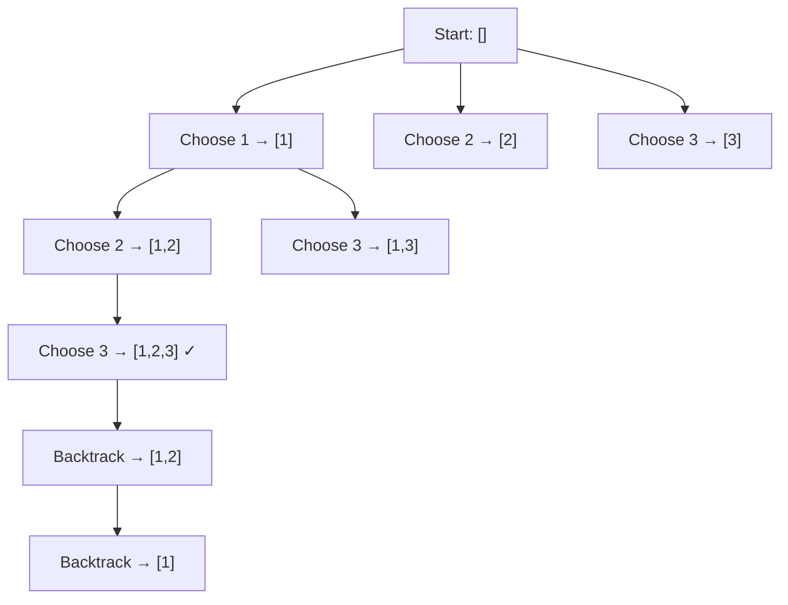

# Pattern 25: Backtracking

## 👶 Explain Like I'm 5

You're in a maze. You walk forward, and whenever you hit a dead end, you
**backtrack** — go back to the last fork in the road and try a different path.
That's backtracking! You systematically explore ALL possible paths, pruning
dead ends early.
It's like solving a Sudoku puzzle: try a number, check if it's valid, go to
the next cell. If you get stuck, erase and try the next number.

---

## 🧩 Core Idea & Pattern Detection

**Backtracking = Recursive exploration + Undo (backtrack)**

The key template:
```python
def backtrack(state, choices):
    if is_solution(state):
        result.append(copy_of(state))
        return
    for choice in choices:
        if is_valid(choice, state):
            make_choice(state, choice)    # Choose
            backtrack(state, next_choices) # Explore
            undo_choice(state, choice)    # Un-choose (BACKTRACK)
```

### When to use it:
- Generate ALL possible solutions (permutations, combinations, subsets).
- Find ONE valid solution (Sudoku, N-Queens).
- Search-space has structure where invalid branches can be pruned early.
- Keywords: "all combinations", "all permutations", "generate all", "find all paths".

---

## 🔧 Visual Anatomy



---

## ⏱️ Complexity Analysis

| Problem | Time | Space |
|---------|------|-------|
| Combination Sum | O(N^(T/min)) | O(T/min) recursion depth |
| Word Search | O(N*M*4^L) | O(L) stack |
| Permutations | O(N!) | O(N) stack |
| Sudoku Solver | O(9^81) worst, much better with pruning | O(81) |

---

## ✅ Problems in This Pattern

| # | Problem | Difficulty | LeetCode |
|---|---------|------------|----------|
| 1 | Combination Sum | Medium | #39 |
| 2 | Word Search | Medium | #79 |
| 3 | Factor Combinations | Medium | #254 |
| 4 | Split String Into Max Unique Substrings | Medium | #1593 |
| 5 | Sudoku Solver | Hard | #37 |
