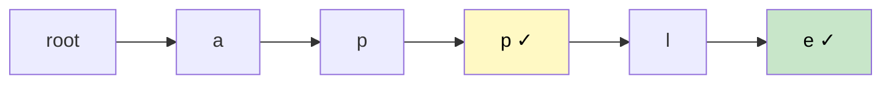

# 🚶‍♂️ Walkthrough: Implement Trie (Prefix Tree)

## 👶 Explain Like I'm 5
A **Trie** (pronounced "try") is a tree where each path from root to a node spells out a word or prefix. Instead of storing whole strings, each edge represents one character.

Think of it like a file system tree for words:
- `root → a → p → p` (stores "app")
- `root → a → p → p → l → e` (stores "apple")

## 🎯 Core Strategy
Two classes: **`TrieNode`** and **`Trie`**.

**`TrieNode`**:
- `children: dict[str, TrieNode]` — maps character to child node.
- `is_end: bool` — marks if a complete word ends at this node.

**Operations**:

### Insert(word)
Walk character by character. If a child for that character doesn't exist, create one. At the last character, mark `is_end = True`.

### Search(word)
Walk character by character. If any character is missing, return `False`. At the end, return `node.is_end` (True only if a full word was inserted here, not just a prefix).

### StartsWith(prefix)
Same as `search` but return `True` as soon as we reach the end of the prefix — we don't check `is_end`.

## 🏃‍♂️ Step-by-Step Execution (Dry Run)
**Insert "apple", then insert "app"**

```
Insert "apple":
root → [a] → [p] → [p] → [l] → [e] (is_end=True)

Insert "app":
root → [a] → [p] → [p] (is_end=True)
                ↓
               [l] → [e] (is_end=True)
```

- `search("apple")` → traverse to `e`, `is_end=True` → ✅ `True`
- `search("app")` → traverse to second `p`, `is_end=True` → ✅ `True`
- `starts_with("ap")` → traverse to first `p`, exists → ✅ `True`
- `search("ap")` → traverse to first `p`, `is_end=False` → ❌ `False`

## 📊 Visual Diagram


*`✓` = `is_end=True`*

## 🛑 Complexity
- **Insert/Search/StartsWith:** $O(L)$ where $L$ = word length.
- **Space:** $O(N \times L)$ where $N$ = number of words — each word stores at most $L$ new nodes.
