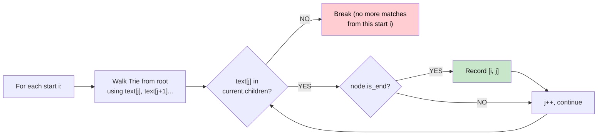

# 🚶‍♂️ Walkthrough: Index Pairs of a String

## 👶 Explain Like I'm 5
Given a text and a list of words, find every `[i, j]` pair where `text[i..j]` exactly matches one of the words.

Naive approach: for every starting position, check against every word. Slow! Trie approach: build one Trie from all words, then for each starting position, just walk the Trie.

## 🎯 Core Strategy
**Build Trie → Scan text from every start position**.

1. **Build Trie** from all words.
2. For each `i` from `0` to `n-1`:
   - Start at the Trie root.
   - Walk forward with `j = i, i+1, ...` using `text[j]`.
   - If `text[j]` is not a child of the current node → break (no word with this prefix from `i`).
   - If `node.is_end` → record `[i, j]` as a match.
3. **Return** all recorded pairs (they're naturally sorted since we iterate `i` and `j` in order).

## 🏃‍♂️ Step-by-Step Execution (Dry Run)
**Input**: `text = "ababa"`, `words = ["aba", "ab"]`

Trie contains: `a→b→(is_end=True)` and `a→b→a→(is_end=True)`.

| i | j | text[j] | is_end? | Record? |
|---|---|---|---|---|
| 0 | 0 | `a` | — | — |
| 0 | 1 | `b` | `ab` is_end ✅ | [0,1] |
| 0 | 2 | `a` | `aba` is_end ✅ | [0,2] |
| 0 | 3 | `b` | no child → break | — |
| 1 | 1 | `b` | no `b` child from root → break | — |
| 2 | 2 | `a` | — | — |
| 2 | 3 | `b` | `ab` is_end ✅ | [2,3] |
| 2 | 4 | `a` | `aba` is_end ✅ | [2,4] |

**Result**: `[[0,1], [0,2], [2,3], [2,4]]` ✅

## 📊 Visual Diagram

## 🛑 Complexity
- **Time:** $O(N \times L)$ where $N$ = text length, $L$ = max word length.
- **Space:** $O(M \times L)$ for the Trie where $M$ = number of words.
