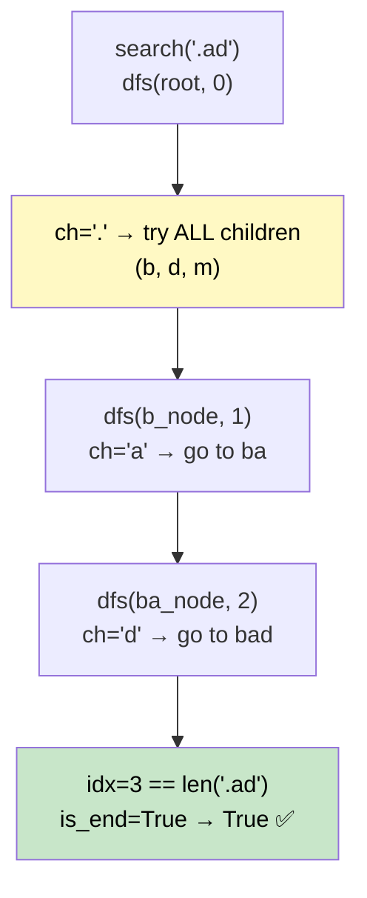

# 🚶‍♂️ Walkthrough: Design Add and Search Words Data Structure

## 👶 Explain Like I'm 5
Build a dictionary that supports inserting words and searching for them — BUT the search pattern can use `'.'` as a wildcard that matches ANY single letter.

`"d.g"` matches `"dog"`, `"dig"`, `"dag"`, etc.

## 🎯 Core Strategy
**Trie + DFS for wildcards**.

### `add_word(word)`
Standard Trie insert. Walk character by character, creating nodes. Mark `is_end = True` at the last node.

### `search(word)` — DFS
**`dfs(node, idx)`**:
- **Base case**: `idx == len(word)` → return `node.is_end`.
- For regular char `ch`: go to `node.children[ch]` if it exists, else return `False`.
- For `'.'` wildcard: **try ALL children** — return `True` if ANY child leads to success.

The wildcard case is where the DFS branching happens. In the worst case (all dots), we explore all paths: $O(26^L)$.

## 🏃‍♂️ Step-by-Step Execution (Dry Run)
**Words added**: `"bad"`, `"dad"`, `"mad"`
**Search**: `".ad"`

```
dfs(root, 0) — ch = '.'
  Try child 'b': dfs(node_b, 1) — ch = 'a'
    dfs(node_ba, 2) — ch = 'd'
      dfs(node_bad, 3) — idx==3 → is_end=True ✅ Return True!
Return True!
```

## 📊 Visual Diagram



## 🛑 Complexity
- **Add:** $O(L)$.
- **Search:** $O(L)$ average for no wildcards; $O(26^L)$ worst case (all dots).
- **Space:** $O(N \times L)$ for the Trie.
