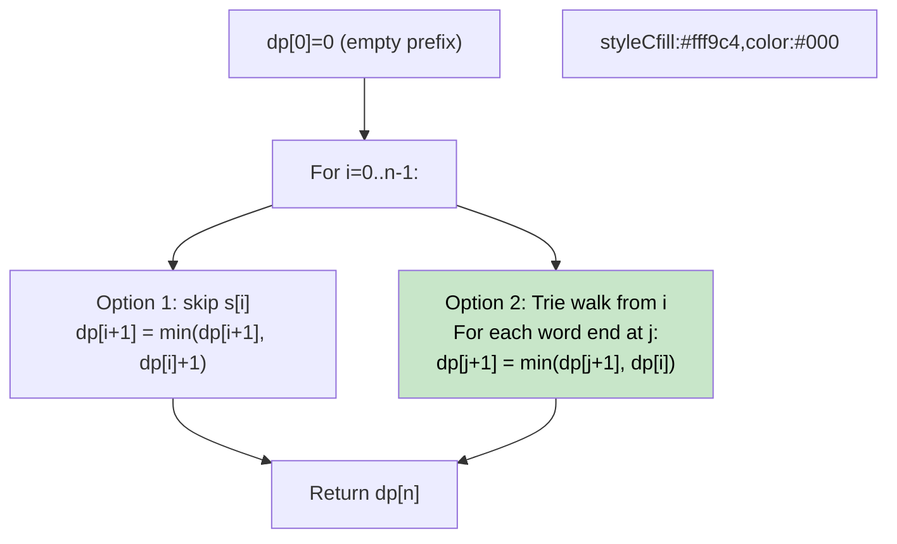

# 🚶‍♂️ Walkthrough: Extra Characters in a String

## 👶 Explain Like I'm 5
You have a string like `"leetscode"` and a dictionary `["leet", "code"]`. You want to split the string using dictionary words. Any character that doesn't belong to any word is "extra." Find the minimum number of extra characters.

`"leetscode"` → `"leet" + "s" + "code"` → 1 extra (`s`).

## 🎯 Core Strategy
**Trie + DP**.

`dp[i]` = minimum extra characters for the first `i` characters of `s` (i.e., `s[0..i-1]`).

1. **Build Trie** from the dictionary.
2. **DP Transition** for each `i` from `0` to `n-1`:
   - **Option 1**: Treat `s[i]` as an extra character → `dp[i+1] = min(dp[i+1], dp[i] + 1)`.
   - **Option 2**: Match a dictionary word starting at `i`. Walk the Trie forward from `i`. Whenever we hit `node.is_end` at position `j`, update `dp[j+1] = min(dp[j+1], dp[i])` (no extra chars for `s[i..j]`).
3. **Return** `dp[n]`.

## 🏃‍♂️ Step-by-Step Execution (Dry Run)
**Input**: `s = "leetscode"`, `dict = ["leet", "code", "leetcode"]`

Initial DP: `dp = [0, ∞, ∞, ∞, ∞, ∞, ∞, ∞, ∞, ∞]`

| i | Trie walk | Updates |
|---|---|---|
| 0 | walk `l,e,e,t` → is_end at j=3 | dp[4]=min(∞,dp[0])=0; dp[1]=min(∞,1)=1 |
| 1 | no matching prefix | dp[2]=2 |
| ... | ... | ... |
| 4 | walk `s` → not in trie | dp[5]=min(∞,dp[4]+1)=1 |
| 5 | walk `c,o,d,e` → is_end at j=8 | dp[9]=min(∞,dp[5])=1 |

**Return `dp[9] = 1`** ✅

## 📊 Visual Diagram

## 🛑 Complexity
- **Time:** $O(N^2 + M \times L)$ — DP transitions + Trie build.
- **Space:** $O(M \times L + N)$ — Trie + DP array.
