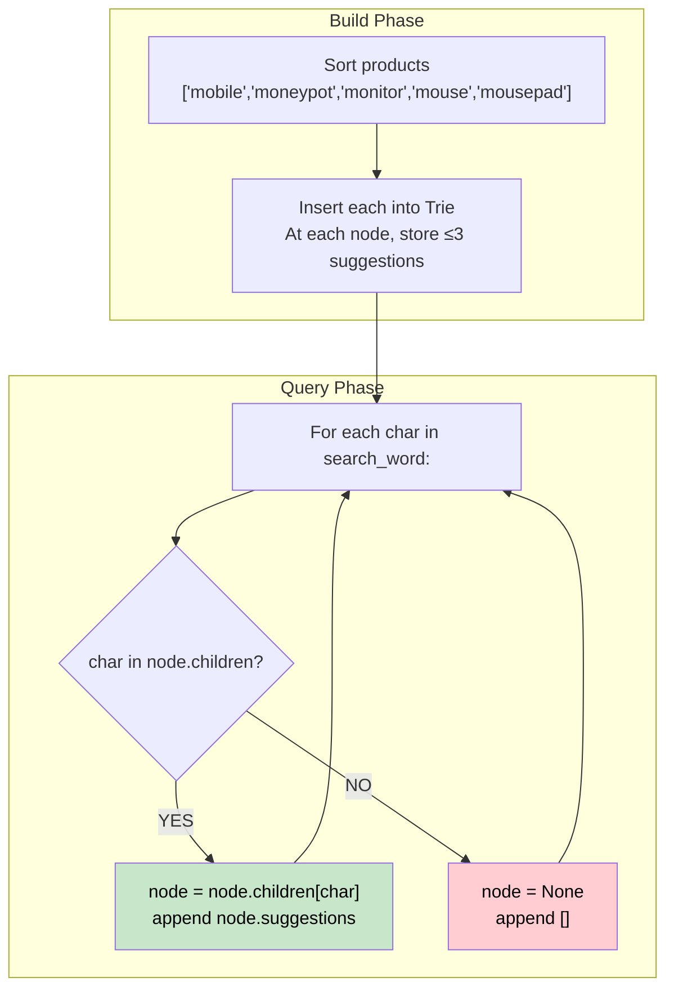

# 🚶‍♂️ Walkthrough: Search Suggestions System

## 👶 Explain Like I'm 5
This is exactly how autocomplete works! You have a list of products. As you type each character of a search word, show up to 3 product suggestions that match the typed prefix — sorted alphabetically.

## 🎯 Core Strategy
**Trie with suggestions pre-stored at each node**.

1. **Sort products lexicographically** — ensures the first 3 products encountered at any Trie node are the lexicographically smallest.
2. **Build Trie**: For each product, walk character by character. At each node along the path, append the product to `node.suggestions` — but only if `len < 3` (keep at most 3).
3. **Query**: For each character `ch` in `search_word`:
   - Advance `node = node.children[ch]` if exists.
   - Append `node.suggestions[:]` to result.
   - If the character doesn't exist in children, all subsequent queries return `[]`.

## 🏃‍♂️ Step-by-Step Execution (Dry Run)
**Products (sorted)**: `["mobile", "moneypot", "monitor", "mouse", "mousepad"]`
**Search word**: `"mouse"`

Trie built with suggestions at each node for prefix `m`:
- Node `m`: `["mobile", "moneypot", "monitor"]` (first 3)
- Node `mo`: `["mobile", "moneypot", "monitor"]`
- Node `mou`: `["mouse", "mousepad"]`
- Node `mous`: `["mouse", "mousepad"]`
- Node `mouse`: `["mouse", "mousepad"]`

Querying `"mouse"` prefix by prefix:
- `m` → `["mobile", "moneypot", "monitor"]`
- `mo` → `["mobile", "moneypot", "monitor"]`
- `mou` → `["mouse", "mousepad"]`
- `mous` → `["mouse", "mousepad"]`
- `mouse` → `["mouse", "mousepad"]`

## 📊 Visual Diagram

## 🛑 Complexity
- **Time:** $O(M \log M + M \times L + N \times L)$ — sort + Trie build + queries.
- **Space:** $O(M \times L)$ — Trie with suggestions lists (total 3 per node, bounded by total Trie nodes).
- **Key Insight**: By sorting first and storing ≤3 per node during insertion, query is $O(1)$ per character (just return `node.suggestions`).
