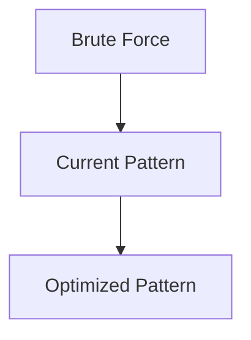

# Pattern 26: Trie (Prefix Tree)

## 👶 Explain Like I'm 5

A Trie is like a dictionary organized as a tree.
Imagine each word is a path through the tree, letter by letter.
"app" and "apple" share the path A→P→P, then apple has an extra L→E.
This means if you look up "app", you've automatically checked the first
3 letters of "apple" too — no repeated work!
Tries are perfect for PREFIX searches: "Find all words starting with 'pre'".

---

## 🧩 Core Idea & Pattern Detection

**Trie = Each node represents ONE character, children represent next characters.**

```
root
 ├── a
 │   └── p
 │       └── p (end)
 │           └── l
 │               └── e (end)
 └── b
     └── a
         └── t (end)
```

### When to use it:
- Prefix matching / autocomplete.
- Word existence check in a dictionary of words.
- "Does any word in my set start with X?"
- Keywords: "prefix", "suggest", "search words", "autocomplete".

---

## 🔧 TrieNode Structure

```python
class TrieNode:
    def __init__(self):
        self.children: dict[str, TrieNode] = {}
        self.is_end: bool = False
```

---

## ⏱️ Complexity Analysis

| Operation | Time | Space |
|-----------|------|-------|
| Insert | O(L) | O(L) per word |
| Search | O(L) | O(1) |
| StartsWith | O(L) | O(1) |

Where L = word length.

---

## ✅ Problems in This Pattern

| # | Problem | Difficulty | LeetCode |
|---|---------|------------|----------|
| 1 | Implement Trie (Prefix Tree) | Medium | #208 |
| 2 | Index Pairs of a String | Easy | #1065 |
| 3 | Design Add and Search Words Data Structure | Medium | #211 |
| 4 | Extra Characters in a String | Medium | #2707 |
| 5 | Search Suggestions System | Medium | #1268 |


## 📦 Prerequisite Data Structures
- Basic understanding of Arrays, Hash Maps, and Trie fundamentals.


## 🔍 How to Spot This Pattern (Signal Detection)
- **Keywords**: "minimize", "maximize", "combinations", "shortest", "longest".
- **Problem Constraints**: Indicates whether O(N), O(N log N), or O(2^N) is acceptable.


## 🔧 Algorithmic Anatomy
### Variable Table
| Variable | Purpose |
|---|---|
| `result` | Stores the final answer |
| `visited` | Tracks seen elements to avoid cycles or re-processing |

### Step-by-Step Recipe
1. Initialize data structures.
2. Iterate through the input.
3. Update state based on current element.
4. Return result.

### Loop Invariants
- At the start of each iteration, the state reflects the optimal solution up to the previous element.

### DOs and DON'Ts
- **DO**: Trace through an example manually before coding.
- **DON'T**: Forget edge cases like empty inputs.


## 🏗️ Template / Boilerplate Code
```python
def solve_trie(nums):
    # Initialize state
    result = 0
    for num in nums:
        # Process num
        pass
    return result
```


## 🔄 Brute Force → Optimal Evolution
- **Brute Force**: Try all possibilities (often O(N^2) or O(2^N)).
- **Optimal**: Use this pattern to reduce redundant work to O(N) or O(N log N).


## 🔗 Pattern Connections



## ⚠️ Common Mistakes & Pitfalls
- Off-by-one errors in loop boundaries.
- Not handling negative numbers or zero correctly.
- Forgetting to update the result variable inside the loop.


## 🎤 Interview Communication Guide
1. **Acknowledge**: "This looks like a variation of the classic problem..."
2. **Propose**: "I'll use this pattern because it optimizes the brute force O(N^2) to O(N)."
3. **Execute**: Write clean, modular code.
4. **Review**: Trace with the provided edge case.


## 🧪 Self-Test Questions
<details>
<summary>When should you use this pattern?</summary>
When the problem asks for optimal subarrays, combinations, or specific mathematical properties.
</details>
<details>
<summary>What is the typical time complexity?</summary>
Usually O(N) or O(N log N), depending on sorting or data structure overhead.
</details>
