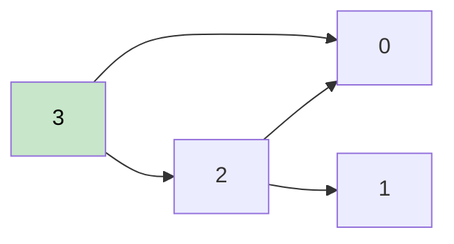

# 🚶‍♂️ Walkthrough: Topological Sort

## 👶 Explain Like I'm 5
Imagine you have tasks where some tasks must be done before others. Topological Sort gives you a valid ordering where every dependency is satisfied.

Think of getting dressed: you must put on underwear before pants, socks before shoes. Topological Sort finds one valid order.

## 🎯 Core Strategy
**Kahn's Algorithm (BFS)** — process nodes with no remaining dependencies first.

1. **Build** an adjacency list and compute `in_degree` for each node (how many nodes point to it).
2. **Seed Queue** with all nodes having `in_degree = 0` (no prerequisites).
3. **Process**:
   - Pop a node, add to `result`.
   - For each neighbor, decrement their `in_degree`. If it becomes 0, enqueue them.
4. **Cycle Detection**: If `len(result) != total_vertices`, a cycle exists → return `[]`.

## 🏃‍♂️ Step-by-Step Execution (Dry Run)
**Input**: `vertices = 4`, `edges = [[3,2],[3,0],[2,0],[2,1]]`

Adjacency: `3→{2,0}`, `2→{0,1}`
In-degrees: `0:2, 1:1, 2:1, 3:0`

| Step | Queue | Pop | result | in_degree updates |
|---|---|---|---|---|
| Init | `[3]` | — | `[]` | — |
| 1 | `[]` | 3 | `[3]` | 2→0, 0→1 |
| 2 | `[2]` | 2 | `[3,2]` | 0→0, 1→0 |
| 3 | `[0,1]` | 0 | `[3,2,0]` | — |
| 4 | `[1]` | 1 | `[3,2,0,1]` | — |

**Result**: `[3, 2, 0, 1]` ✅

## 📊 Visual Diagram

*Process nodes with no incoming edges first (node 3 has `in_degree=0`).*

## 🛑 Complexity
- **Time:** $O(V + E)$ — each vertex and edge processed once.
- **Space:** $O(V + E)$.
- **Cycle**: If cycle exists, some vertices are never enqueued (their in-degree never reaches 0). `len(result) < V` signals this.
