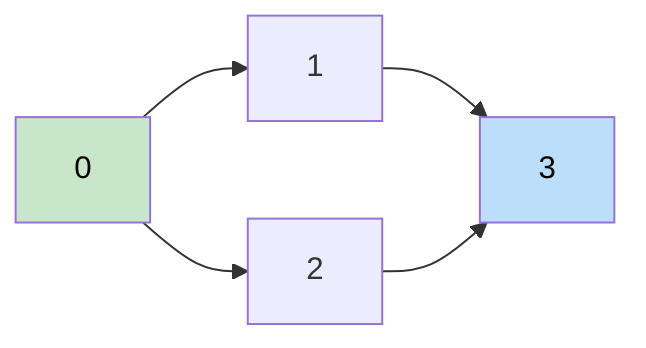

# 🚶‍♂️ Walkthrough: Tasks Scheduling (Course Schedule)

## 👶 Explain Like I'm 5
You have `N` courses and some prerequisites: `[a, b]` means "take `b` before `a`."
Can you finish ALL courses without a circular dependency?

If course A requires B and B requires A — impossible! This is a cycle. Use Topological Sort to detect it.

## 🎯 Core Strategy
**Kahn's BFS — cycle detection**.

Same as topological sort, but we only care about WHETHER a valid ordering exists:
- If all `N` courses are eventually scheduled → return `True`.
- If `finished < N` after BFS → cycle detected → return `False`.

1. Build adjacency list: `[prereq] → [course]`.
2. Compute `in_degree` for each course.
3. BFS from all courses with `in_degree = 0`.
4. Count `finished`. Return `finished == num_courses`.

## 🏃‍♂️ Step-by-Step Execution (Dry Run)
**Input**: `num_courses=4`, `prerequisites=[[1,0],[2,0],[3,1],[3,2]]`

Graph: `0→{1,2}`, `1→{3}`, `2→{3}`
In-degrees: `0:0, 1:1, 2:1, 3:2`

| Queue | Pop | finished | Updates |
|---|---|---|---|
| `[0]` | 0 | 1 | 1→0, 2→0 |
| `[1,2]` | 1 | 2 | 3→1 |
| `[2]` | 2 | 3 | 3→0 |
| `[3]` | 3 | 4 | — |

`finished=4 == num_courses=4` → **Return `True`** ✅

## 📊 Visual Diagram

## 🛑 Complexity
- **Time:** $O(V + E)$.
- **Space:** $O(V + E)$.
- **Cycle check**: `[1,0],[0,1]` → both have `in_degree=1`. Neither reaches 0. Queue stays empty. `finished=0 ≠ 2` → `False`.
