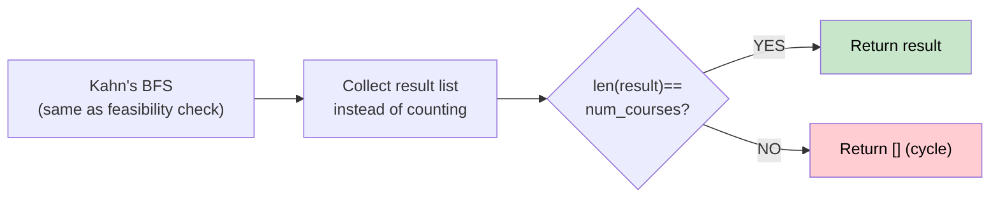

# 🚶‍♂️ Walkthrough: Tasks Scheduling Order (Course Schedule II)

## 👶 Explain Like I'm 5
Same as Course Schedule I — but now instead of just asking "is it possible?", return the **actual order** to take the courses. If impossible (cycle), return `[]`.

## 🎯 Core Strategy
Identical to Problem 02 (Course Schedule), but we **collect the result** in a list instead of just counting.

**Kahn's BFS:**
1. Build graph and `in_degree`.
2. Seed queue with all courses of `in_degree = 0`.
3. Pop → append to `result` → update neighbors.
4. Return `result` if `len(result) == num_courses`, else `[]`.

## 🏃‍♂️ Step-by-Step Execution (Dry Run)
**Input**: `num_courses=2`, `prerequisites=[[1,0]]`

Graph: `0→{1}`. In-degrees: `0:0, 1:1`.

| Queue | Pop | result |
|---|---|---|
| `[0]` | 0 | `[0]` |
| `[1]` | 1 | `[0,1]` |

`len([0,1]) == 2` → **Return `[0, 1]`** ✅

## 📊 Visual Diagram

## 🛑 Complexity
- **Time:** $O(V + E)$.
- **Space:** $O(V + E)$.
- **Multiple valid orderings exist** — this returns ONE valid ordering. The exact order depends on which `in_degree=0` nodes were seeded into the queue first.
