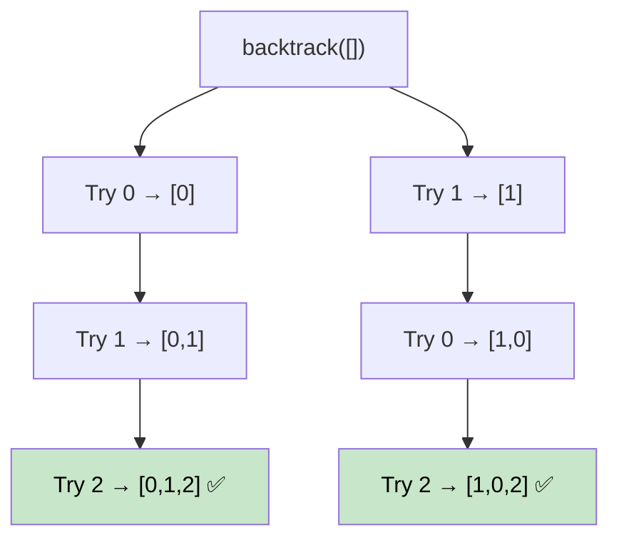

# 🚶‍♂️ Walkthrough: All Tasks Scheduling Orders

## 👶 Explain Like I'm 5
Instead of finding ONE valid ordering, find ALL possible valid orderings. This is a classic NP problem solved with **backtracking on top of Kahn's algorithm**.

## 🎯 Core Strategy
**Kahn's BFS + Backtracking**.

At each recursive step, all nodes with `in_degree = 0` are valid "next choices." Instead of picking just one (like standard Kahn's), we try EACH of them and recurse:

**`backtrack(current)`**:
1. Find `available = [v for v if in_degree[v] == 0]`.
2. If `available` is empty and `len(current) == vertices` → record solution.
3. For each `node` in `available`:
   - **Choose**: append `node`, set `in_degree[node] = -1` (mark chosen), decrement neighbors.
   - **Explore**: call `backtrack(current)`.
   - **Unchoose**: pop `node`, restore `in_degree[node] = 0`, restore neighbors.

## 🏃‍♂️ Step-by-Step Execution (Dry Run)
**Input**: `vertices=3`, `edges=[[0,2],[1,2]]` (0 and 1 must come before 2)

Initial `in_degree`: `{0:0, 1:0, 2:2}`

```
backtrack([])
  available = [0, 1]
  Try 0: backtrack([0])
    available = [1]
    Try 1: backtrack([0,1])
      available = [2]
      Try 2: backtrack([0,1,2]) → Record [0,1,2] ✅
  Try 1: backtrack([1])
    available = [0]
    Try 0: backtrack([1,0])
      available = [2]
      Try 2: backtrack([1,0,2]) → Record [1,0,2] ✅
```

**Result**: `[[0,1,2], [1,0,2]]` ✅

## 📊 Visual Diagram



## 🛑 Complexity
- **Time:** $O(V! \times (V + E))$ worst case — exponential (all orderings).
- **Space:** $O(V)$ recursion depth.
