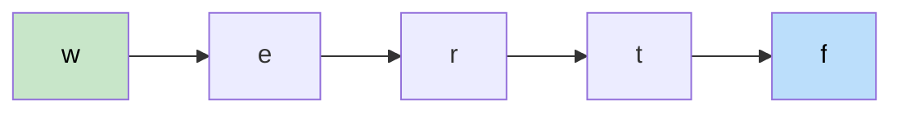

# 🚶‍♂️ Walkthrough: Alien Dictionary

## 👶 Explain Like I'm 5
You have a sorted list of words in an alien language. By comparing adjacent words, you can infer the order of alien characters.

`"wrt"` comes before `"wrf"` → first difference is `t` vs `f` at index 2 → **`t` comes before `f`** in the alien alphabet.

Collect all such ordering constraints, then topological sort them to get the full alphabet order.

## 🎯 Core Strategy
**Pairwise comparison → Graph edges → Kahn's topological sort**.

1. **Collect unique characters** as graph vertices.
2. **Compare adjacent words**:
   - If `word1` is a longer prefix of `word2` → invalid, return `""`.
   - First differing character pair: add edge `word1[j] → word2[j]`.
3. **Kahn's BFS** on the character graph.
4. If result includes all characters → return the ordering. If cycle → return `""`.

## 🏃‍♂️ Step-by-Step Execution (Dry Run)
**Words**: `["wrt","wrf","er","ett","rftt"]`

| Pair | First diff | Edge |
|---|---|---|
| wrt, wrf | `t` vs `f` | t → f |
| wrf, er | `w` vs `e` | w → e |
| er, ett | `r` vs `t` | r → t |
| ett, rftt | `e` vs `r` | e → r |

Edges: `t→f`, `w→e`, `r→t`, `e→r`
In-degrees: `f:1`, `e:1`, `t:1`, `r:1`, `w:0`

Kahn's gives order: `w → e → r → t → f` → `"wertf"` ✅

## 📊 Visual Diagram

## 🛑 Complexity
- **Time:** $O(C)$ where $C$ = total characters across all words.
- **Space:** $O(1)$ — character graph bounded by 26 letters.
- **Cycle**: e.g., `["z","x","z"]` — `z→x` and `x→z` form a cycle. Kahn's leaves both with `in_degree > 0`. Return `""`.
