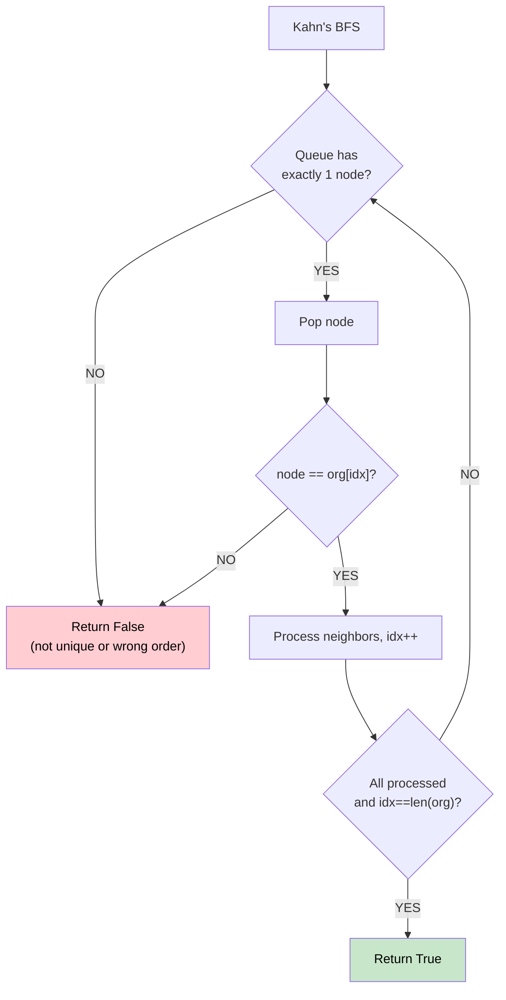

# 🚶‍♂️ Walkthrough: Reconstructing a Sequence

## 👶 Explain Like I'm 5
Given an original sequence `org` and some subsequences `seqs`, can `org` be uniquely reconstructed from `seqs`? In other words, is `org` the ONE AND ONLY valid topological ordering implied by all the subsequences?

If at any step there are two or more nodes equally valid as "next," then the ordering isn't unique → return `False`.

## 🎯 Core Strategy
**Kahn's BFS with a uniqueness check**.

Build a directed graph from consecutive pairs in each subsequence. Then run Kahn's BFS with one critical check:

- At each step, the queue must have **exactly 1 node**. If `len(queue) > 1`, multiple valid orderings exist → return `False`.
- The single node in the queue must equal `org[idx]` (it must match the original sequence).

If we process all nodes and they match `org` exactly → return `True`.

## 🏃‍♂️ Step-by-Step Execution (Dry Run)
**Input**: `org=[1,2,3]`, `seqs=[[1,2],[1,3],[2,3]]`

Edges: `1→2`, `1→3`, `2→3`.
In-degrees: `{1:0, 2:1, 3:2}`.

| Queue | len | Pop | org[idx] | Match? |
|---|---|---|---|---|
| `[1]` | 1 ✅ | 1 | 1 | ✅ |
| `[2]` | 1 ✅ | 2 | 2 | ✅ |
| `[3]` | 1 ✅ | 3 | 3 | ✅ |

Processed all 3, matches `org` exactly → **Return `True`** ✅

## 📊 Visual Diagram

## 🛑 Complexity
- **Time:** $O(V + E)$.
- **Space:** $O(V + E)$.
