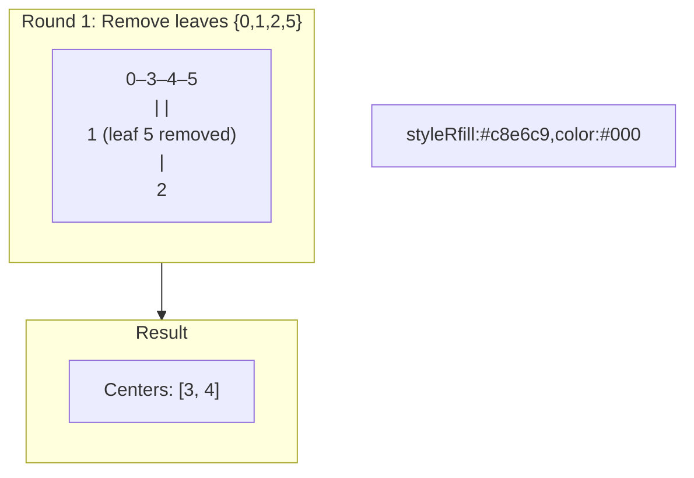

# 🚶‍♂️ Walkthrough: Minimum Height Trees

## 👶 Explain Like I'm 5
In a tree (undirected, connected, no cycles), any node can be the root. Depending on which node is the root, the tree has a different height. Find which node(s) give the **minimum height tree**.

**Key Insight**: The root(s) of a minimum height tree are always the **center(s)** of the tree — at most 1 or 2 nodes.

Think of it like this: imagine grabbing the tree from its leaves and pulling. The last node(s) hanging in the middle are the centers.

## 🎯 Core Strategy
**Leaf-Peeling (Topological Sort from the outside in)**.

Repeatedly remove all current leaf nodes (degree 1) in waves, shrinking the tree from outside in:

1. Build adjacency sets and find initial leaves (nodes with only 1 neighbor).
2. While `remaining > 2`:
   - Record current leaf count. `remaining -= leaf_count`.
   - For each leaf, remove it from its neighbor's adjacency set. If that neighbor becomes a leaf (degree 1), add it to `new_leaves`.
3. The remaining 1–2 nodes are the centers.

## 🏃‍♂️ Step-by-Step Execution (Dry Run)
**Input**: `n=6`, `edges=[[3,0],[3,1],[3,2],[3,4],[5,4]]`

Tree structure: `0,1,2` connected to `3`; `3` connected to `4`; `5` connected to `4`.

Initial leaves: `{0, 1, 2, 5}` (degree 1). `remaining = 6`.

**Round 1**: Remove `{0,1,2,5}`. `remaining = 2`.
- `3` loses neighbors 0,1,2 → degree = 1 (→ leaf).
- `4` loses neighbor 5 → degree = 1 (→ leaf).
- `new_leaves = [3, 4]`.

`remaining = 2 ≤ 2` → **Return `[3, 4]`** ✅

## 📊 Visual Diagram

## 🛑 Complexity
- **Time:** $O(N)$ — each node is removed exactly once.
- **Space:** $O(N)$ for adjacency sets.
- **Edge cases**: `n=1` → `[0]`. `n=2` → `[0, 1]`. Always at most 2 roots.
