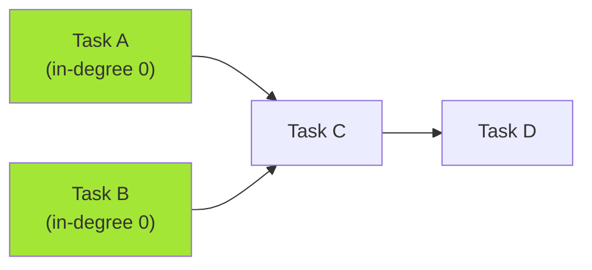

# Pattern 27: Topological Sort (Graph)

## 👶 Explain Like I'm 5

You're getting dressed. You must put on your socks BEFORE your shoes.
You must put on your underwear BEFORE your pants.
But can you put on your shirt before your shoes? YES — they don't depend on each other.
Topological Sort finds a VALID ORDER to do tasks that have DEPENDENCIES.
It only works on **Directed Acyclic Graphs (DAGs)** — no circular dependencies allowed.

---

## 🧩 Core Idea & Pattern Detection

**Topological Sort = Order nodes so all edges point "forward" (left to right).**

### Kahn's Algorithm (BFS approach):
1. Build adjacency list + in-degree count for each node.
2. Initialize queue with all nodes of in-degree 0 (no dependencies).
3. While queue not empty: pop a node, add to result, decrement in-degree of neighbors.
   If any neighbor's in-degree hits 0, add it to the queue.
4. If result has all nodes → valid ordering. If not → CYCLE DETECTED!

### When to use it:
- Task scheduling with dependencies.
- Build order for packages.
- Course prerequisites.
- Keywords: "prerequisites", "dependency order", "can finish", "sequence".

---

## 🔧 Visual Diagram

---

## ⏱️ Complexity Analysis

| Aspect | Complexity | Why |
|--------|-----------|-----|
| **Time** | O(V + E) | Visit each vertex and edge once |
| **Space** | O(V + E) | Adjacency list + in-degree array |

---

## ✅ Problems in This Pattern

| # | Problem | Difficulty | LeetCode |
|---|---------|------------|----------|
| 1 | Topological Sort | Medium | Classic |
| 2 | Tasks Scheduling (Course Schedule) | Medium | #207 |
| 3 | Tasks Scheduling Order | Medium | #210 |
| 4 | All Tasks Scheduling Orders | Hard | Classic |
| 5 | Alien Dictionary | Hard | #269 |
| 6 | Reconstructing a Sequence | Hard | #444 |
| 7 | Minimum Height Trees | Hard | #310 |
