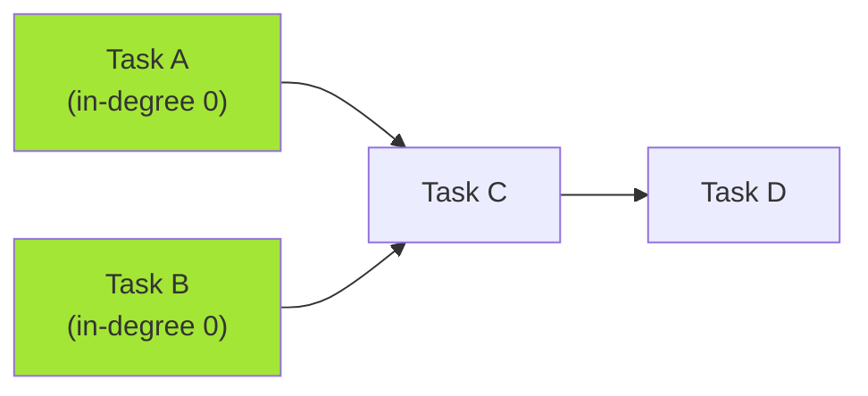
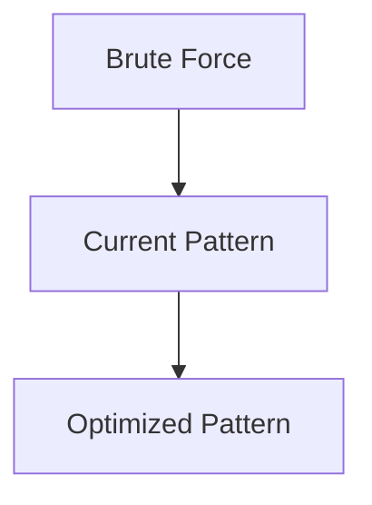

# Pattern 27: Topological Sort (Graph)

## 👶 Explain Like I'm 5

You're getting dressed. You must put on your socks BEFORE your shoes.
You must put on your underwear BEFORE your pants.
But can you put on your shirt before your shoes? YES — they don't depend on each other.
Topological Sort finds a VALID ORDER to do tasks that have DEPENDENCIES.
It only works on **Directed Acyclic Graphs (DAGs)** — no circular dependencies allowed.

---

## 🧩 Core Idea & Pattern Detection

**Topological Sort = Order nodes so all edges point "forward" (left to right).**

### Kahn's Algorithm (BFS approach):
1. Build adjacency list + in-degree count for each node.
2. Initialize queue with all nodes of in-degree 0 (no dependencies).
3. While queue not empty: pop a node, add to result, decrement in-degree of neighbors.
   If any neighbor's in-degree hits 0, add it to the queue.
4. If result has all nodes → valid ordering. If not → CYCLE DETECTED!

### When to use it:
- Task scheduling with dependencies.
- Build order for packages.
- Course prerequisites.
- Keywords: "prerequisites", "dependency order", "can finish", "sequence".

---

## 🔧 Visual Diagram



---

## ⏱️ Complexity Analysis

| Aspect | Complexity | Why |
|--------|-----------|-----|
| **Time** | O(V + E) | Visit each vertex and edge once |
| **Space** | O(V + E) | Adjacency list + in-degree array |

---

## ✅ Problems in This Pattern

| # | Problem | Difficulty | LeetCode |
|---|---------|------------|----------|
| 1 | Topological Sort | Medium | Classic |
| 2 | Tasks Scheduling (Course Schedule) | Medium | #207 |
| 3 | Tasks Scheduling Order | Medium | #210 |
| 4 | All Tasks Scheduling Orders | Hard | Classic |
| 5 | Alien Dictionary | Hard | #269 |
| 6 | Reconstructing a Sequence | Hard | #444 |
| 7 | Minimum Height Trees | Hard | #310 |


## 📦 Prerequisite Data Structures
- Basic understanding of Arrays, Hash Maps, and Topological Sort (Graph) fundamentals.


## 🔍 How to Spot This Pattern (Signal Detection)
- **Keywords**: "minimize", "maximize", "combinations", "shortest", "longest".
- **Problem Constraints**: Indicates whether O(N), O(N log N), or O(2^N) is acceptable.


## 🔧 Algorithmic Anatomy
### Variable Table
| Variable | Purpose |
|---|---|
| `result` | Stores the final answer |
| `visited` | Tracks seen elements to avoid cycles or re-processing |

### Step-by-Step Recipe
1. Initialize data structures.
2. Iterate through the input.
3. Update state based on current element.
4. Return result.

### Loop Invariants
- At the start of each iteration, the state reflects the optimal solution up to the previous element.

### DOs and DON'Ts
- **DO**: Trace through an example manually before coding.
- **DON'T**: Forget edge cases like empty inputs.


## 🏗️ Template / Boilerplate Code
```python
def solve_topological_sort_graph(nums):
    # Initialize state
    result = 0
    for num in nums:
        # Process num
        pass
    return result
```


## 🔄 Brute Force → Optimal Evolution
- **Brute Force**: Try all possibilities (often O(N^2) or O(2^N)).
- **Optimal**: Use this pattern to reduce redundant work to O(N) or O(N log N).


## 🔗 Pattern Connections



## ⚠️ Common Mistakes & Pitfalls
- Off-by-one errors in loop boundaries.
- Not handling negative numbers or zero correctly.
- Forgetting to update the result variable inside the loop.


## 🎤 Interview Communication Guide
1. **Acknowledge**: "This looks like a variation of the classic problem..."
2. **Propose**: "I'll use this pattern because it optimizes the brute force O(N^2) to O(N)."
3. **Execute**: Write clean, modular code.
4. **Review**: Trace with the provided edge case.


## 🧪 Self-Test Questions
<details>
<summary>When should you use this pattern?</summary>
When the problem asks for optimal subarrays, combinations, or specific mathematical properties.
</details>
<details>
<summary>What is the typical time complexity?</summary>
Usually O(N) or O(N log N), depending on sorting or data structure overhead.
</details>
