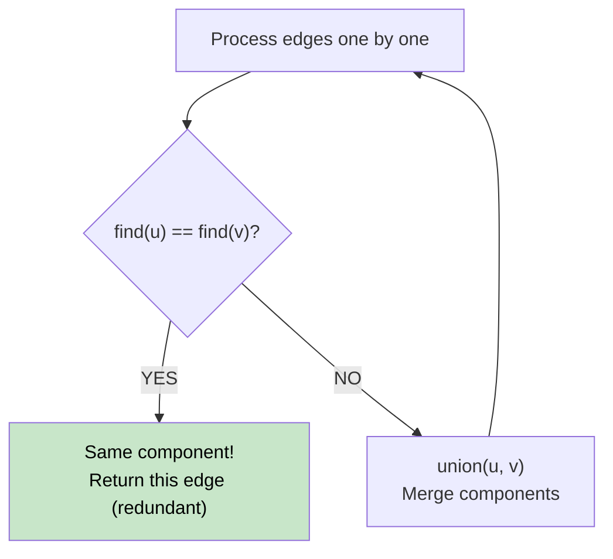

# 🚶‍♂️ Walkthrough: Redundant Connection

## 👶 Explain Like I'm 5
You have a tree (N nodes, N-1 edges, fully connected). Someone added ONE extra edge, creating exactly one cycle. Find and return that redundant edge.

As you add edges one by one, the redundant edge is the FIRST one that connects two nodes that are already in the same group (i.e., already connected by existing edges).

## 🎯 Core Strategy
**Union-Find (Disjoint Set Union)**:

Maintain a `parent` and `rank` array. Process edges one by one:
- `find(x)` → returns the root representative of `x`'s component (with **path compression**).
- `union(x, y)` → merges `x` and `y`'s components (by **rank** for balance). Returns `False` if already in the same component.

For each edge `(u, v)`:
- If `find(u) == find(v)` → CYCLE! This edge is redundant → return it.
- Else: `union(u, v)`.

## 🏃‍♂️ Step-by-Step Execution (Dry Run)
**Input**: `[[1,2],[1,3],[2,3]]`

| Edge | find(u) | find(v) | Same? | Action |
|---|---|---|---|---|
| (1,2) | 1 | 2 | No | union → parent[2]=1 |
| (1,3) | 1 | 3 | No | union → parent[3]=1 |
| (2,3) | **1** | **1** | **YES** | Return [2,3] ✅ |

## 📊 Visual Diagram

## 🛑 Complexity
- **Time:** $O(N \cdot \alpha(N)) \approx O(N)$ — $\alpha$ is the inverse Ackermann function, effectively constant.
- **Space:** $O(N)$.
- **Path Compression**: `parent[x] = find(parent[x])` flattens the tree during `find`, making future calls faster.
- **Union by Rank**: Always attach the shorter tree under the taller, keeping the tree flat.
