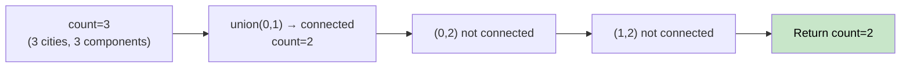

# 🚶‍♂️ Walkthrough: Number of Provinces

## 👶 Explain Like I'm 5
Cities can be directly connected. A "province" is a group of cities all reachable from each other (a connected component). How many provinces are there?

This is the classic **connected components counting** problem.

## 🎯 Core Strategy
**Union-Find with component counter**.

The `UnionFind` class tracks a `count` (starts at `n`, the number of cities). Every time we successfully `union` two different components, `count -= 1`.

1. Initialize `UnionFind(n)`.
2. Iterate the upper triangle of `is_connected` matrix (avoid double-counting).
3. For each `is_connected[i][j] == 1`: call `uf.union(i, j)`.
4. Return `uf.count`.

## 🏃‍♂️ Step-by-Step Execution (Dry Run)
**Input**: `[[1,1,0],[1,1,0],[0,0,1]]` (n=3)

- `count = 3`
- `(0,1)`: connected → `union(0,1)` → `count = 2`
- `(0,2)`: not connected.
- `(1,2)`: not connected.

**Return `count = 2`** ✅ (Province 1: {0,1}, Province 2: {2})

## 📊 Visual Diagram

## 🛑 Complexity
- **Time:** $O(N^2 \cdot \alpha(N))$ — iterating the matrix dominates.
- **Space:** $O(N)$.
