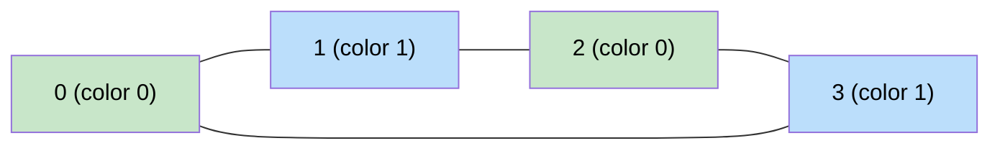

# 🚶‍♂️ Walkthrough: Is Graph Bipartite?

## 👶 Explain Like I'm 5
A graph is bipartite if you can color every node with one of two colors such that **no two adjacent nodes share the same color** (like coloring a chessboard — black and white, never two blacks touching).

A graph is NOT bipartite if it has an odd-length cycle.

## 🎯 Core Strategy
**BFS 2-coloring** (not Union-Find here — the problem uses BFS as the optimal approach).

1. `color = [-1] * n` (uncolored).
2. For each unvisited node `start`, run BFS:
   - Color `start = 0`.
   - For each neighbor:
     - If uncolored → color it with `1 - current_color`.
     - If already colored the **same** as current → NOT bipartite → return `False`.
3. If BFS completes without conflict → return `True`.

**Why BFS works**: BFS layers alternate between the two "sides" of a bipartite graph. An odd cycle means we'd reach a node from the wrong side.

## 🏃‍♂️ Step-by-Step Execution (Dry Run)
**Input**: `graph = [[1,3],[0,2],[1,3],[0,2]]` (a 4-cycle: 0-1-2-3-0)

| Step | node | color | neighbor | result |
|---|---|---|---|---|
| Init | 0 | 0 | — | — |
| BFS | 0 | 0 | 1,3 → color=1 | — |
| BFS | 1 | 1 | 0(color=0 ≠ 1 ✅), 2 → color=0 | — |
| BFS | 3 | 1 | 0(color=0 ≠ 1 ✅), 2(color=0 ≠ 1 ✅) | — |

No conflict → **Return `True`** ✅

## 📊 Visual Diagram

## 🛑 Complexity
- **Time:** $O(V + E)$.
- **Space:** $O(V)$.
