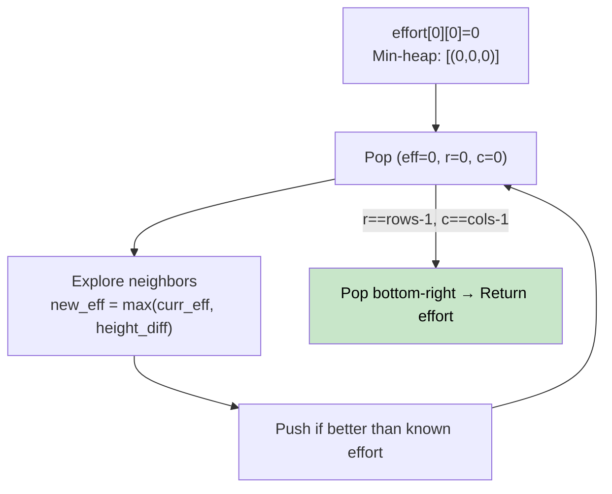

# 🚶‍♂️ Walkthrough: Path With Minimum Effort

## 👶 Explain Like I'm 5
You have a grid of heights. Walk from top-left to bottom-right. At every step, you pay the absolute height difference. The total "effort" of a path is the **maximum** single-step difference along that path.

Find the path that minimizes this maximum step difference.

This is the **min bottleneck path** problem — and it's perfectly solved with a Dijkstra-style approach where "distance" = current max effort.

## 🎯 Core Strategy
**Dijkstra with a modified cost function**.

`effort[r][c]` = minimum possible max-step-difference to reach `(r, c)`.

1. Initialize `effort[0][0] = 0`, all others `= ∞`.
2. Use a **min-heap**: `(effort_so_far, row, col)`.
3. Pop the cell with the lowest current effort.
4. For each of 4 neighbors `(nr, nc)`:
   - `new_eff = max(current_eff, abs(height[nr][nc] - height[r][c]))`.
   - If `new_eff < effort[nr][nc]`: update and push to heap.
5. Return as soon as we pop the bottom-right cell.

## 🏃‍♂️ Step-by-Step Execution (Dry Run)
**Input**:
```
1  2  2
3  8  2
5  3  5
```

Best path: `1→2→2→2→5` → max diff = `max(1,0,0,3) = 3`? Actually `1→2→2→2→2` gives effort 1.
Best is `1→2→2→2→5` or `1→3→5→3→5` — the answer is `2`.

Path `(0,0)→(0,1)→(0,2)→(1,2)→(2,2)`:
- diffs: `|2-1|=1, |2-2|=0, |2-2|=0, |5-2|=3` → max=3.

Path `(0,0)→(1,0)→(2,0)→(2,1)→(2,2)`:
- diffs: `|3-1|=2, |5-3|=2, |3-5|=2, |5-3|=2` → max=2 ✅.

**Return `2`** ✅

## 📊 Visual Diagram



## 🛑 Complexity
- **Time:** $O(N \times M \times \log(N \times M))$ — Dijkstra with heap.
- **Space:** $O(N \times M)$ for the effort array and heap.
