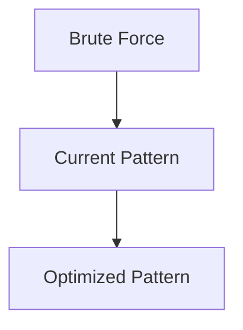

# Pattern 28: Union Find (Disjoint Set Union)

## 👶 Explain Like I'm 5

Imagine a school with students. Some students are friends with each other,
and friends-of-friends are in the same "friend group".
Union Find answers: **"Are two students in the same friend group?"** in near-O(1) time.
Every student has a "representative" (like a group leader).
- **Find**: "Who is my group leader?"
- **Union**: "Merge two groups by making one leader point to the other."

---

## 🧩 Core Idea & Pattern Detection

**Union Find = Efficient group membership with path compression + union by rank.**

```python
class UnionFind:
    def __init__(self, n: int) -> None:
        self.parent = list(range(n))  # each node is its own parent
        self.rank = [0] * n           # tree height approximation

    def find(self, x: int) -> int:
        if self.parent[x] != x:
            self.parent[x] = self.find(self.parent[x])  # path compression
        return self.parent[x]

    def union(self, x: int, y: int) -> bool:
        rx, ry = self.find(x), self.find(y)
        if rx == ry:
            return False  # already in same group
        if self.rank[rx] < self.rank[ry]:
            rx, ry = ry, rx
        self.parent[ry] = rx
        if self.rank[rx] == self.rank[ry]:
            self.rank[rx] += 1
        return True
```

### When to use it:
- Connected components in a graph.
- Detecting cycles in undirected graphs.
- Kruskal's Minimum Spanning Tree.
- Keywords: "connected", "same group", "merge", "redundant connection".

---

## ⏱️ Complexity Analysis

| Operation | Complexity |
|-----------|-----------|
| Find | O(α(N)) ≈ O(1) amortized |
| Union | O(α(N)) ≈ O(1) amortized |
| Space | O(N) |

(α = inverse Ackermann function, effectively constant for all practical N)

---

## ✅ Problems in This Pattern

| # | Problem | Difficulty | LeetCode |
|---|---------|------------|----------|
| 1 | Redundant Connection | Medium | #684 |
| 2 | Number of Provinces | Medium | #547 |
| 3 | Is Graph Bipartite? | Medium | #785 |
| 4 | Path With Minimum Effort | Medium | #1631 |


## 📦 Prerequisite Data Structures
- Basic understanding of Arrays, Hash Maps, and Union Find fundamentals.


## 🔍 How to Spot This Pattern (Signal Detection)
- **Keywords**: "minimize", "maximize", "combinations", "shortest", "longest".
- **Problem Constraints**: Indicates whether O(N), O(N log N), or O(2^N) is acceptable.


## 🔧 Algorithmic Anatomy
### Variable Table
| Variable | Purpose |
|---|---|
| `result` | Stores the final answer |
| `visited` | Tracks seen elements to avoid cycles or re-processing |

### Step-by-Step Recipe
1. Initialize data structures.
2. Iterate through the input.
3. Update state based on current element.
4. Return result.

### Loop Invariants
- At the start of each iteration, the state reflects the optimal solution up to the previous element.

### DOs and DON'Ts
- **DO**: Trace through an example manually before coding.
- **DON'T**: Forget edge cases like empty inputs.


## 🏗️ Template / Boilerplate Code
```python
def solve_union_find(nums):
    # Initialize state
    result = 0
    for num in nums:
        # Process num
        pass
    return result
```


## 🔄 Brute Force → Optimal Evolution
- **Brute Force**: Try all possibilities (often O(N^2) or O(2^N)).
- **Optimal**: Use this pattern to reduce redundant work to O(N) or O(N log N).


## 🔗 Pattern Connections



## ⚠️ Common Mistakes & Pitfalls
- Off-by-one errors in loop boundaries.
- Not handling negative numbers or zero correctly.
- Forgetting to update the result variable inside the loop.


## 🎤 Interview Communication Guide
1. **Acknowledge**: "This looks like a variation of the classic problem..."
2. **Propose**: "I'll use this pattern because it optimizes the brute force O(N^2) to O(N)."
3. **Execute**: Write clean, modular code.
4. **Review**: Trace with the provided edge case.


## 🧪 Self-Test Questions
<details>
<summary>When should you use this pattern?</summary>
When the problem asks for optimal subarrays, combinations, or specific mathematical properties.
</details>
<details>
<summary>What is the typical time complexity?</summary>
Usually O(N) or O(N log N), depending on sorting or data structure overhead.
</details>
