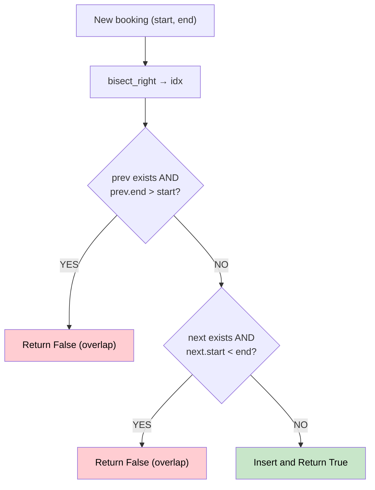

# 🚶‍♂️ Walkthrough: My Calendar I

## 👶 Explain Like I'm 5
You're booking events with start and end times. No two events can overlap. Return `True` if a new booking is possible, `False` otherwise.

The key insight: if we keep bookings sorted by start time, we only need to check the **previous** and **next** bookings to detect overlap.

## 🎯 Core Strategy
**Sorted List + Binary Search** using `bisect`.

1. Maintain `self.calendar` as a sorted list of `(start, end)` tuples.
2. For each new booking `(start, end)`:
   - Use `bisect_right` to find where it would be inserted.
   - Check **previous booking** (idx-1): if it ends AFTER our start → overlap → `False`.
   - Check **next booking** (idx): if it starts BEFORE our end → overlap → `False`.
   - Insert and return `True`.

Two events `[a, b)` and `[c, d)` overlap iff `max(a, c) < min(b, d)`.

## 🏃‍♂️ Step-by-Step Execution (Dry Run)
**Bookings**: `book(10,20)`, `book(15,25)`, `book(20,30)`

| Call | Calendar before | idx | Prev check | Next check | Result |
|---|---|---|---|---|---|
| (10,20) | `[]` | 0 | — | — | Insert → `True` |
| (15,25) | `[(10,20)]` | 1 | prev.end=20>15 ❌ | — | `False` |
| (20,30) | `[(10,20)]` | 1 | prev.end=20>20? NO ✅ | No next | Insert → `True` |

## 📊 Visual Diagram

## 🛑 Complexity
- **Time:** $O(\log N)$ for search, $O(N)$ for insertion in Python list.
- **Space:** $O(N)$.
