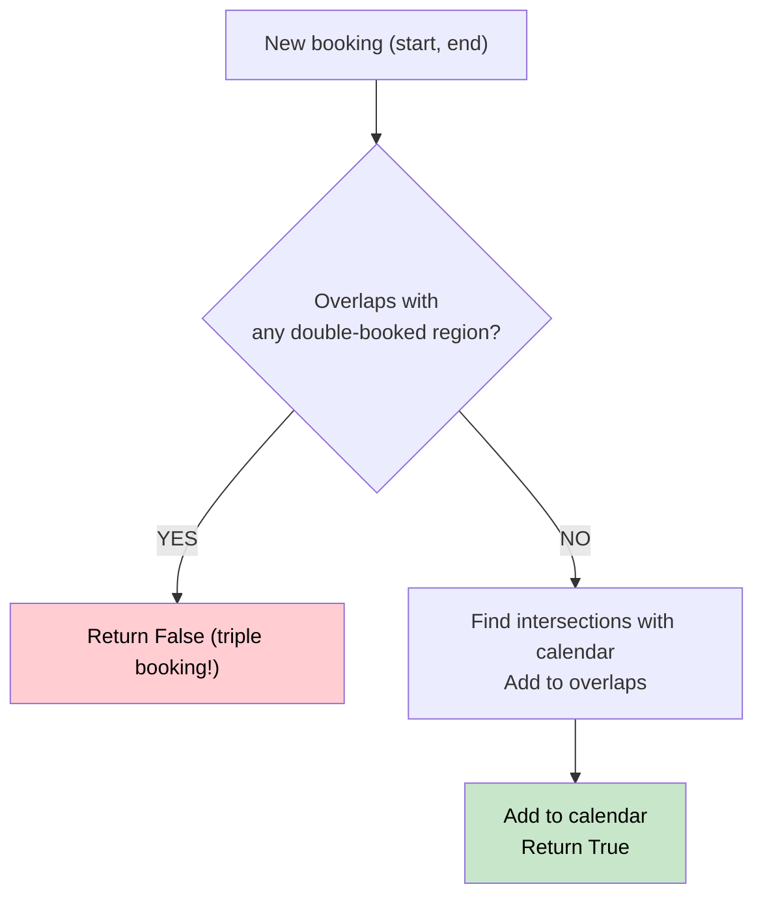

# 🚶‍♂️ Walkthrough: My Calendar II

## 👶 Explain Like I'm 5
Same as Calendar I, but now double-booking (2 events at same time) is OK. Triple-booking (3 events at same time) is NOT.

Strategy: track not just single bookings but also the "overlap" regions (where exactly 2 events coincide). If a new event overlaps with any existing overlap → it becomes triple → reject.

## 🎯 Core Strategy
**Two Lists: `calendar` + `overlaps`**.

- `calendar`: all accepted bookings.
- `overlaps`: all regions that are already double-booked.

For each new `(start, end)`:
1. **Check triple**: if it overlaps with any entry in `overlaps` → return `False`.
2. **Find new overlaps**: for each entry in `calendar`, compute the intersection with the new booking. Add those intersections to `overlaps`.
3. **Add to calendar**.

Overlap of `[a,b)` and `[c,d)`: `[max(a,c), min(b,d))` — valid if `start < end`.

## 🏃‍♂️ Step-by-Step Execution (Dry Run)

| book(s,e) | overlaps before | Triple? | New overlaps | calendar |
|---|---|---|---|---|
| (10,20) | `[]` | No | None | `[(10,20)]` |
| (50,60) | `[]` | No | None | `[(10,20),(50,60)]` |
| (10,40) | `[]` | No | `(10,20)` | `[...,(10,40)]` |
| (5,15) | `[(10,20)]` | YES! `(10,15)` overlap → **False** | — | unchanged |

## 📊 Visual Diagram

## 🛑 Complexity
- **Time:** $O(N)$ per booking (scanning both lists).
- **Space:** $O(N)$.
