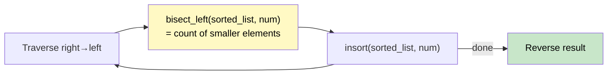

# 🚶‍♂️ Walkthrough: Count of Smaller Numbers After Self

## 👶 Explain Like I'm 5
For each number in an array, count how many numbers to its **right** are smaller than it.
`[5, 2, 6, 1]` → `[2, 1, 1, 0]` (5 has 2 and 1 after it that are smaller, etc.)

## 🎯 Core Strategy
**Right-to-Left traversal + Sorted List (Ordered Set)**.

Process from right to left. At each step, we've already seen all numbers to the right and stored them in a sorted list. For the current number, use `bisect_left` to find how many numbers in the sorted list are strictly smaller than it.

1. Initialize `sorted_list = []`, `result = []`.
2. Traverse `nums` from right to left:
   - `idx = bisect_left(sorted_list, num)` — count of elements `< num`.
   - `result.append(idx)`.
   - `bisect.insort(sorted_list, num)` — insert in sorted order.
3. Return `result[::-1]`.

## 🏃‍♂️ Step-by-Step Execution (Dry Run)
**Input**: `[5, 2, 6, 1]`

| num (right→left) | sorted_list before | bisect_left | Insert |
|---|---|---|---|
| 1 | `[]` | 0 | `[1]` |
| 6 | `[1]` | 1 | `[1,6]` |
| 2 | `[1,6]` | 1 | `[1,2,6]` |
| 5 | `[1,2,6]` | 2 | `[1,2,5,6]` |

Results collected right→left: `[0, 1, 1, 2]` → reversed: `[2, 1, 1, 0]` ✅

## 📊 Visual Diagram

## 🛑 Complexity
- **True Time:** $O(N \log N)$ with a Fenwick Tree or Balanced BST.
- **Python `bisect.insort`:** $O(N^2)$ due to list shifting — acceptable for interview demos.
- **Space:** $O(N)$.
