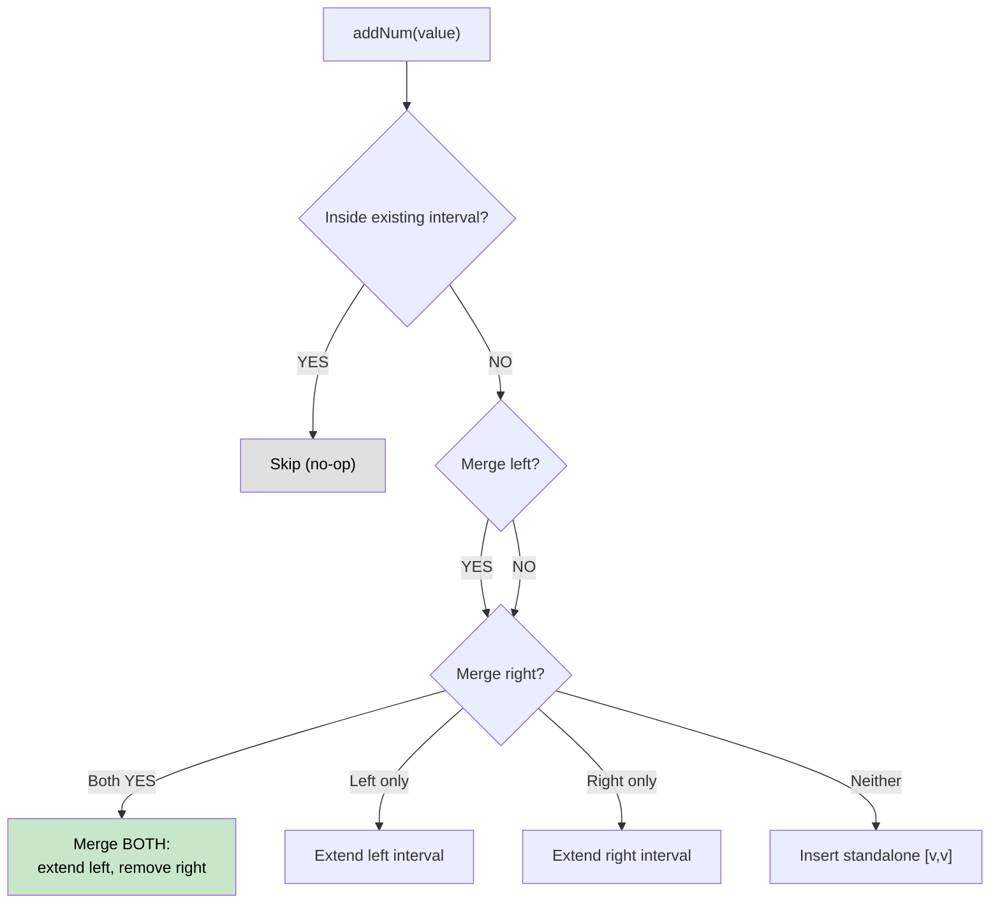

# 🚶‍♂️ Walkthrough: Data Stream as Disjoint Intervals

## 👶 Explain Like I'm 5
You receive numbers one at a time from a stream. At any point, return all numbers received so far as a list of merged, non-overlapping intervals.

Adding `2` when you have `[[1,1],[3,3]]` merges everything into `[[1,3]]` because 2 bridges 1 and 3.

## 🎯 Core Strategy
**Sorted list of disjoint intervals + bisect for insertion**.

Maintain `self.intervals` sorted by start. When adding a new `value`:

1. Use `bisect_right` to find its insertion position `idx`.
2. **Already included?** If `intervals[idx-1][0] <= value <= intervals[idx-1][1]` → skip.
3. **Merge left?** `intervals[idx-1][1] + 1 == value` → extend left interval's end.
4. **Merge right?** `intervals[idx][0] - 1 == value` → extend right interval's start.
5. **Merge both?** Do both merges → remove right interval.
6. **Standalone?** Insert `[value, value]`.

## 🏃‍♂️ Step-by-Step Execution (Dry Run)
**Stream**: `1, 3, 7, 2, 6`

| addNum | Action | intervals |
|---|---|---|
| 1 | Standalone | `[[1,1]]` |
| 3 | Standalone | `[[1,1],[3,3]]` |
| 7 | Standalone | `[[1,1],[3,3],[7,7]]` |
| 2 | Merge left (1) AND right (3) → merge `[1,1]` and `[3,3]` | `[[1,3],[7,7]]` |
| 6 | Merge right (6+1=7) → extend `[7,7]` to `[6,7]` | `[[1,3],[6,7]]` |

## 📊 Visual Diagram

## 🛑 Complexity
- **Time:** $O(N)$ per add (Python list insertion). $O(\log N)$ with a proper Ordered Set.
- **Space:** $O(N)$.
