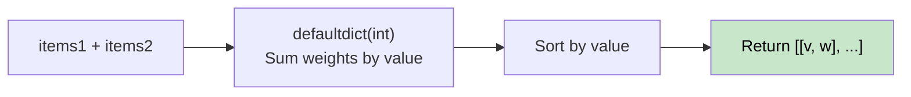

# 🚶‍♂️ Walkthrough: Merge Similar Items

## 👶 Explain Like I'm 5
Two shops each have items with `[value, weight]`. If both shops sell the same value item, combine their weights. Return a sorted list of all unique values with total weights.

Simple aggregation problem — use a dictionary, then sort.

## 🎯 Core Strategy
**Hash Map aggregation + sort**.

1. Use `defaultdict(int)` to sum weights by value from both lists.
2. Sort items by their value (key).
3. Return as a list of `[value, total_weight]` pairs.

## 🏃‍♂️ Step-by-Step Execution (Dry Run)
**Input**: `items1=[[1,1],[4,5],[3,8]]`, `items2=[[3,1],[1,5]]`

| Source | (value, weight) | weight_map |
|---|---|---|
| items1 | (1,1) | {1:1} |
| items1 | (4,5) | {1:1, 4:5} |
| items1 | (3,8) | {1:1, 4:5, 3:8} |
| items2 | (3,1) | {1:1, 4:5, 3:9} |
| items2 | (1,5) | {1:6, 4:5, 3:9} |

Sort by value: `[[1,6], [3,9], [4,5]]` ✅

## 📊 Visual Diagram

## 🛑 Complexity
- **Time:** $O((N+M) \log(N+M))$ — sorting dominates.
- **Space:** $O(N+M)$.
