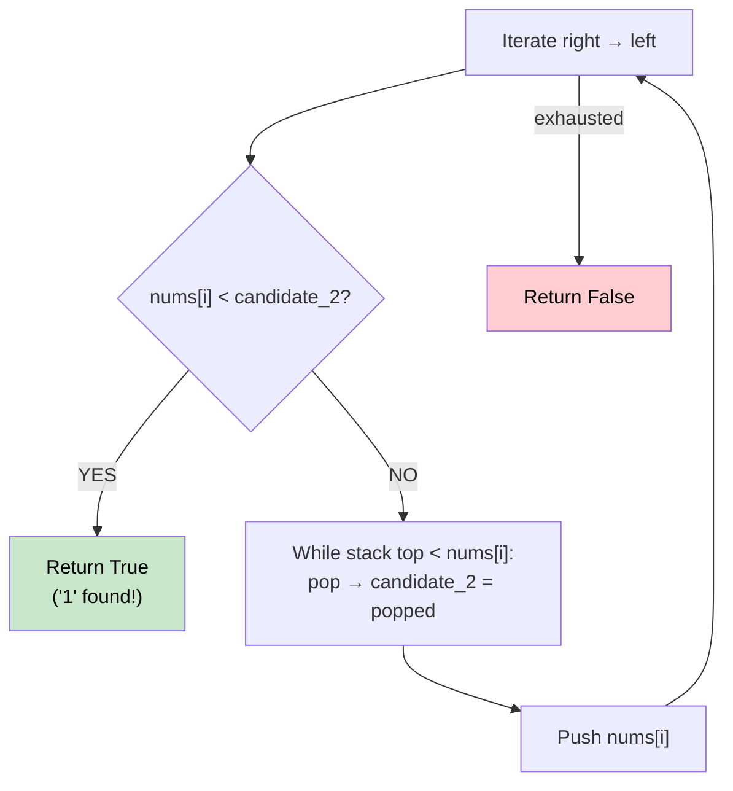

# 🚶‍♂️ Walkthrough: 132 Pattern

## 👶 Explain Like I'm 5
Find three numbers in the array where `nums[i] < nums[k] < nums[j]`, with `i < j < k`.

The pattern looks like: small (1) ... big (3) ... medium (2).

Reading left to right: you see something small, then something large, then something in the middle. The "3" comes BEFORE the "2" in the array.

## 🎯 Core Strategy
**Right-to-left scan with Monotonic Stack**.

Key insight: iterate from **right to left**. 
- `candidate_2` tracks the best "2" (medium element) we've seen so far.
- A **monotonically decreasing stack** tracks potential "3" (large) elements.
- When we pop from the stack (because current element is larger), the popped value becomes `candidate_2`.
- If `nums[i] < candidate_2` at any point, we found our "1" (small element). Return `True`!

**Why right-to-left?** Because when scanning left, we want the "3" and "2" to already be to our right, and we're looking for a "1" to the left of them.

## 🏃‍♂️ Step-by-Step Execution (Dry Run)
**Input**: `[3, 1, 4, 2]`

Right-to-left: `2, 4, 1, 3`

| nums[i] | stack | candidate_2 | nums[i] < cand2? |
|---|---|---|---|
| 2 | push → `[2]` | -∞ | No |
| 4 | 2 < 4 → pop 2, `cand2=2`. Push 4 → `[4]` | 2 | No |
| 1 | 1 < cand2=2? **YES!** → Return `True` ✅ | 2 | **YES** |

## 📊 Visual Diagram

## 🛑 Complexity
- **Time:** $O(N)$ — each element pushed/popped at most once.
- **Space:** $O(N)$ for the stack.
