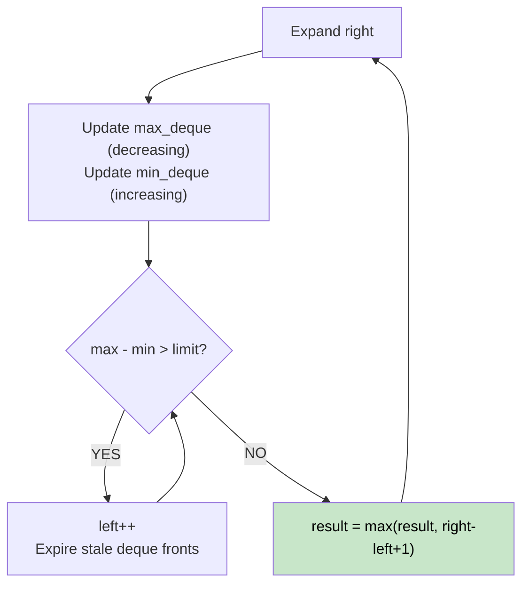

# 🚶‍♂️ Walkthrough: Longest Continuous Subarray With Absolute Diff ≤ Limit

## 👶 Explain Like I'm 5
Find the longest contiguous subarray where the difference between the biggest and smallest number is at most `limit`.

Think of a sliding window that expands on the right and shrinks on the left whenever the range gets too wide. We need to know the **max** and **min** of the current window efficiently — that's where monotonic deques shine.

## 🎯 Core Strategy
**Sliding Window + Two Monotonic Deques** (for max and min tracking).

- `max_deque`: stores indices in decreasing order of `nums[i]`. Front = current max.
- `min_deque`: stores indices in increasing order of `nums[i]`. Front = current min.

For each `right`:
1. **Maintain deques**: pop from back while the new element breaks monotonicity.
2. **Shrink window**: while `nums[max_deque[0]] - nums[min_deque[0]] > limit`, increment `left`. Remove front of deques if they're out of window.
3. **Update result**: `result = max(result, right - left + 1)`.

## 🏃‍♂️ Step-by-Step Execution (Dry Run)
**Input**: `nums = [8, 2, 4, 7]`, `limit = 4`

| right | nums[r] | max_deque | min_deque | max-min | left | result |
|---|---|---|---|---|---|---|
| 0 | 8 | `[0]` | `[0]` | 0 | 0 | 1 |
| 1 | 2 | `[0,1]` | `[1]` | 8-2=6>4 | 1 | 1 |
| 2 | 4 | `[0,2]` | `[1,2]` | 8-2=6>4 | 2 | 1 |
| 3 | 7 | `[3]` | `[2,3]` | 7-4=3≤4 | 2 | **2** |

**Return `2`** ✅

## 📊 Visual Diagram

## 🛑 Complexity
- **Time:** $O(N)$ — each element pushed/popped from deques at most once.
- **Space:** $O(N)$ for both deques.
