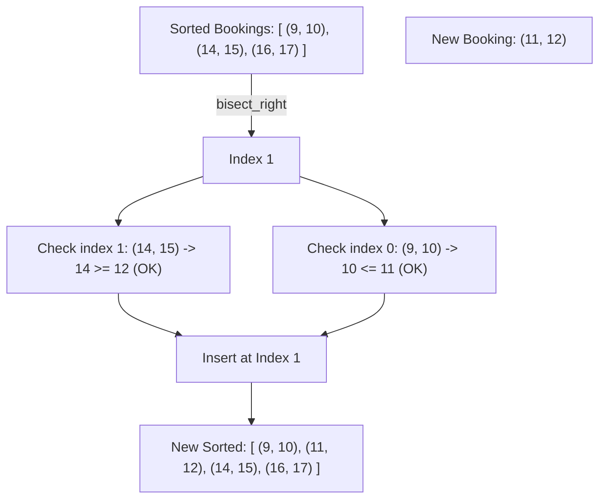
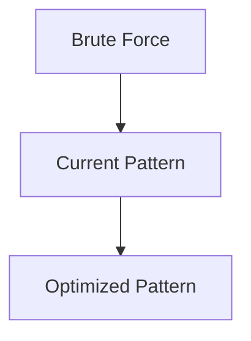

# Pattern 29: Ordered Set

## 👶 Explain Like I'm 5

Imagine you are managing a schedule for a meeting room.
People keep booking times: "I want 10:00 to 11:00". Then "I want 14:00 to 15:00".
If you keep all the bookings in a completely mixed-up list, checking if a new booking
overlaps means looking at EVERY single existing booking (slow!).

Instead, you keep them in an **Ordered Set** (a sorted list that automatically stays sorted).
When a new booking for 12:00 comes in, you can instantly find the bookings right *before* it
and right *after* it, and just check those two!

---

## 🧩 Core Idea & Pattern Detection

An **Ordered Set** allows you to:
1. Insert elements and keep them sorted.
2. Find the smallest element strictly greater than `x` (Upper Bound).
3. Find the largest element strictly less than or equal to `x` (Lower Bound).

*Language Note:*
- C++ has `std::set`. Java has `TreeSet`. Both use Balanced Binary Search Trees (O(log N) insert/find).
- Python **does not** have a built-in Ordered Set. We usually use the `bisect` module on a normal list. Searching is O(log N), but inserting is O(N). In interviews, explain that you'd use a Balanced BST for true O(log N) inserts, but implement it with `bisect`.

### When to use it:
- Booking calendars / intervals where you need to check for overlaps efficiently.
- Finding the nearest values (lower/upper bounds) dynamically as data arrives.
- Keywords: "calendar", "stream of intervals", "smaller numbers after self".

---

## 🔧 Visual Anatomy

Using Binary Search (`bisect`) to find neighbors:



---

## ⏱️ Complexity Analysis

| Operation (Python `bisect`) | Time | Note |
|-----------------------------|------|------|
| **Search (bisect)** | O(log N) | Binary search |
| **Insert (insort)** | O(N) | Shifting array elements |

*(Note: In C++/Java `TreeSet`, Insert is O(log N))*

---

## ✅ Problems in This Pattern

| # | Problem | Difficulty | LeetCode |
|---|---------|------------|----------|
| 1 | My Calendar I | Medium | #729 |
| 2 | My Calendar II | Medium | #731 |
| 3 | Count of Smaller Numbers After Self | Hard | #315 |
| 4 | Data Stream as Disjoint Intervals | Hard | #352 |


## 📦 Prerequisite Data Structures
- Basic understanding of Arrays, Hash Maps, and Ordered Set fundamentals.


## 🔍 How to Spot This Pattern (Signal Detection)
- **Keywords**: "minimize", "maximize", "combinations", "shortest", "longest".
- **Problem Constraints**: Indicates whether O(N), O(N log N), or O(2^N) is acceptable.


## 🔧 Algorithmic Anatomy
### Variable Table
| Variable | Purpose |
|---|---|
| `result` | Stores the final answer |
| `visited` | Tracks seen elements to avoid cycles or re-processing |

### Step-by-Step Recipe
1. Initialize data structures.
2. Iterate through the input.
3. Update state based on current element.
4. Return result.

### Loop Invariants
- At the start of each iteration, the state reflects the optimal solution up to the previous element.

### DOs and DON'Ts
- **DO**: Trace through an example manually before coding.
- **DON'T**: Forget edge cases like empty inputs.


## 🏗️ Template / Boilerplate Code
```python
def solve_ordered_set(nums):
    # Initialize state
    result = 0
    for num in nums:
        # Process num
        pass
    return result
```


## 🔄 Brute Force → Optimal Evolution
- **Brute Force**: Try all possibilities (often O(N^2) or O(2^N)).
- **Optimal**: Use this pattern to reduce redundant work to O(N) or O(N log N).


## 🔗 Pattern Connections



## ⚠️ Common Mistakes & Pitfalls
- Off-by-one errors in loop boundaries.
- Not handling negative numbers or zero correctly.
- Forgetting to update the result variable inside the loop.


## 🎤 Interview Communication Guide
1. **Acknowledge**: "This looks like a variation of the classic problem..."
2. **Propose**: "I'll use this pattern because it optimizes the brute force O(N^2) to O(N)."
3. **Execute**: Write clean, modular code.
4. **Review**: Trace with the provided edge case.


## 🧪 Self-Test Questions
<details>
<summary>When should you use this pattern?</summary>
When the problem asks for optimal subarrays, combinations, or specific mathematical properties.
</details>
<details>
<summary>What is the typical time complexity?</summary>
Usually O(N) or O(N log N), depending on sorting or data structure overhead.
</details>
