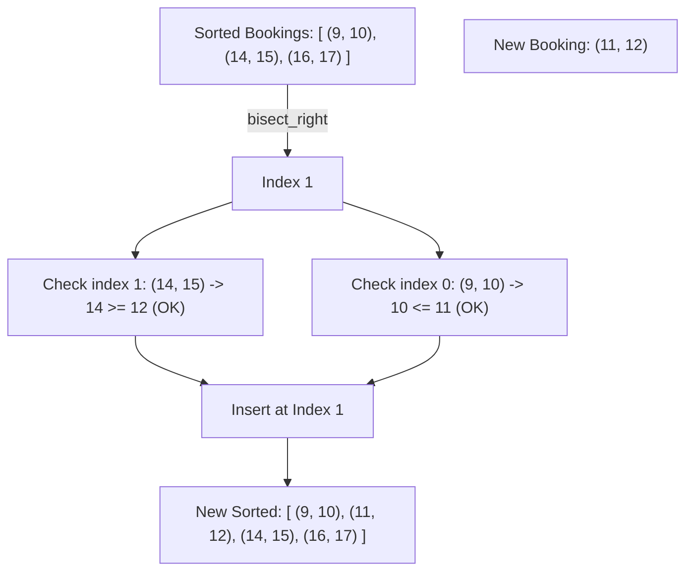

# Pattern 29: Ordered Set

## 👶 Explain Like I'm 5

Imagine you are managing a schedule for a meeting room.
People keep booking times: "I want 10:00 to 11:00". Then "I want 14:00 to 15:00".
If you keep all the bookings in a completely mixed-up list, checking if a new booking
overlaps means looking at EVERY single existing booking (slow!).

Instead, you keep them in an **Ordered Set** (a sorted list that automatically stays sorted).
When a new booking for 12:00 comes in, you can instantly find the bookings right *before* it
and right *after* it, and just check those two!

---

## 🧩 Core Idea & Pattern Detection

An **Ordered Set** allows you to:
1. Insert elements and keep them sorted.
2. Find the smallest element strictly greater than `x` (Upper Bound).
3. Find the largest element strictly less than or equal to `x` (Lower Bound).

*Language Note:*
- C++ has `std::set`. Java has `TreeSet`. Both use Balanced Binary Search Trees (O(log N) insert/find).
- Python **does not** have a built-in Ordered Set. We usually use the `bisect` module on a normal list. Searching is O(log N), but inserting is O(N). In interviews, explain that you'd use a Balanced BST for true O(log N) inserts, but implement it with `bisect`.

### When to use it:
- Booking calendars / intervals where you need to check for overlaps efficiently.
- Finding the nearest values (lower/upper bounds) dynamically as data arrives.
- Keywords: "calendar", "stream of intervals", "smaller numbers after self".

---

## 🔧 Visual Anatomy

Using Binary Search (`bisect`) to find neighbors:

---

## ⏱️ Complexity Analysis

| Operation (Python `bisect`) | Time | Note |
|-----------------------------|------|------|
| **Search (bisect)** | O(log N) | Binary search |
| **Insert (insort)** | O(N) | Shifting array elements |

*(Note: In C++/Java `TreeSet`, Insert is O(log N))*

---

## ✅ Problems in This Pattern

| # | Problem | Difficulty | LeetCode |
|---|---------|------------|----------|
| 1 | My Calendar I | Medium | #729 |
| 2 | My Calendar II | Medium | #731 |
| 3 | Count of Smaller Numbers After Self | Hard | #315 |
| 4 | Data Stream as Disjoint Intervals | Hard | #352 |
