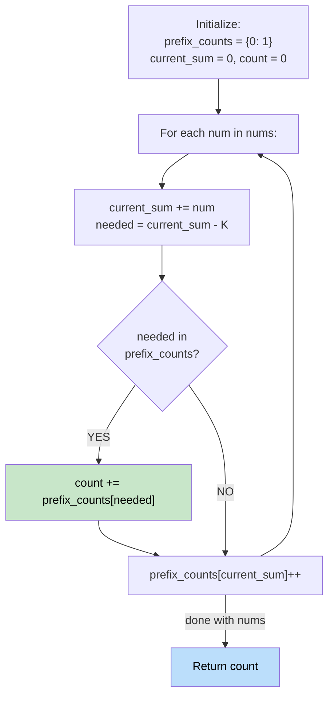

# 🚶‍♂️ Walkthrough: Subarray Sum Equals K

## 👶 Explain Like I'm 5
You have a list of numbers (both positive and negative) and a target `K`. Find how many continuous chunks (subarrays) add up exactly to `K`. 

Because of negative numbers, you can't just expand or shrink a window (a window might grow but its sum might shrink!). Instead, as you walk through the array, keep a running total. If your current total is `C`, and you're looking for a chunk that adds to `K`, you just need to check if you've ever seen a previous total of `C - K`. 

## 🎯 Core Strategy
**Prefix Sum + Hash Map**.

1. Keep a running `current_sum`.
2. Use a hash map `prefix_counts` to store how many times you've seen each prefix sum.
3. Initialize the map with `{0: 1}`. Why? If a prefix itself exactly equals `K`, then `current_sum - K = 0`. This means the subarray from the very beginning is a valid answer.
4. For each number:
   - `current_sum += num`
   - `needed_prefix = current_sum - K`
   - If `needed_prefix` is in the map, add its count to the total count.
   - Add `current_sum` to the map.

## 🏃‍♂️ Step-by-Step Execution (Dry Run)
**Input**: `nums = [1, -1, 0]`, `K = 0`

| num | current_sum | needed_prefix (sum-0) | prefix_counts before | count additions | updated map |
|---|---|---|---|---|---|
| (init) | 0 | - | `{0: 1}` | - | - |
| 1 | 1 | 1 | `{0: 1}` | 1 not in map | `{0:1, 1:1}` |
| -1 | 0 | 0 | `{0:1, 1:1}` | map has 0 (count=1) → `count += 1` | `{0:2, 1:1}` |
| 0 | 0 | 0 | `{0:2, 1:1}` | map has 0 (count=2) → `count += 2` | `{0:3, 1:1}` |

Total valid subarrays = 1 + 2 = 3 ✅ (they are `[1, -1]`, `[1, -1, 0]`, and `[0]`).

## 📊 Visual Diagram

## 🛑 Complexity
- **Time:** $O(N)$ — One pass through the array.
- **Space:** $O(N)$ — The hash map can store up to $N$ distinct prefix sums.
