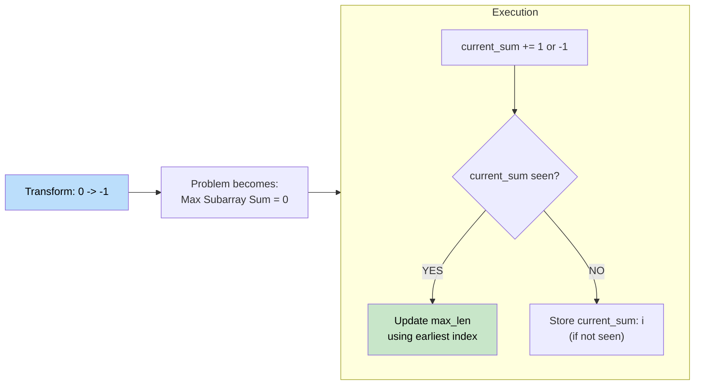

# 🚶‍♂️ Walkthrough: Contiguous Array (Equal 0s and 1s)

## 👶 Explain Like I'm 5
You have an array of `0`s and `1`s. Find the longest contiguous subarray with an EQUAL number of `0`s and `1`s.

If we turn every `0` into a `-1`, then an array with an equal number of `-1`s and `1`s will sum up to exactly `0`. 
Now this problem is exactly identical to "Maximum Size Subarray Sum Equals K", where `K = 0`.

## 🎯 Core Strategy
**Transformation + Prefix Sum Map**.

1. Loop through the array. Treat every `0` as `-1`.
2. Keep a `current_sum`. 
3. Use a hash map to store the first time we see each prefix sum (`{0: -1}`).
4. If we see the same prefix sum again, the elements between the first occurrence and the current index must sum to 0!
5. Update max length.

## 🏃‍♂️ Step-by-Step Execution (Dry Run)
**Input**: `[0, 1, 0]`

Treat as: `[-1, 1, -1]`. Target `K = 0`.

Init: `map = {0: -1}`, `max_len = 0`

| i | num | treated | current_sum | In map? | length (i - map[sum]) | Map updates |
|---|---|---|---|---|---|---|
| 0 | 0 | -1 | -1 | No | - | `{0:-1, -1:0}` |
| 1 | 1 | +1 | 0 | Yes (-1) | 1 - (-1) = **2** | no update (keep earliest) |
| 2 | 0 | -1 | -1 | Yes (0) | 2 - 0 = **2** | no update |

Max length = 2 ✅

## 📊 Visual Diagram

## 🛑 Complexity
- **Time:** $O(N)$
- **Space:** $O(N)$
