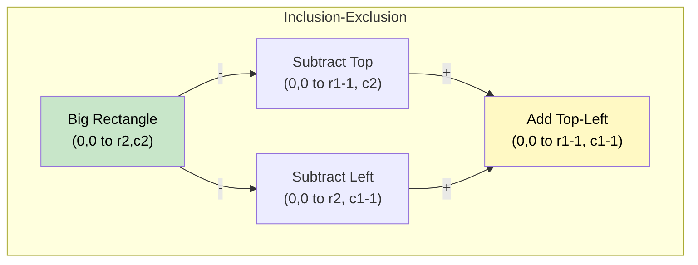

# 🚶‍♂️ Walkthrough: Range Sum Query 2D - Immutable

## 👶 Explain Like I'm 5
You have a 2D grid of numbers. You need to quickly find the sum of any sub-rectangle inside it.
Instead of looping over the rows and columns every time (too slow), we pre-calculate sums starting from the top-left corner (0,0) to every cell.

To get the sum of any rectangle, take the big rectangle from (0,0) to the bottom-right corner, and subtract the parts you don't want (the top piece and the left piece). Add back the top-left corner because you subtracted it twice!

## 🎯 Core Strategy
**2D Prefix Sum (Inclusion-Exclusion Principle)**.

1. Create a `prefix` matrix of size `(R+1) x (C+1)` initialized to 0. (Padding with 0s makes edge cases disappear).
2. **Build**:
   `prefix[r+1][c+1] = matrix[r][c] + prefix[r][c+1] + prefix[r+1][c] - prefix[r][c]`
   *(Current cell + rectangle above + rectangle left - overlap)*.
3. **Query (from r1,c1 to r2,c2)**:
   `sum = prefix[r2+1][c2+1] - prefix[r1][c2+1] - prefix[r2+1][c1] + prefix[r1][c1]`

## 🏃‍♂️ Step-by-Step Execution (Dry Run)
**Matrix**:
```
[3, 0, 1]
[5, 6, 3]
```
**Prefix Matrix** (padded):
```
0  0  0  0
0  3  3  4   (row 0: 3, 3+0, 3+1)
0  8 14 18   (row 1: 3+5, 8+6+0, 14+3+1)
```

**Query**: (1, 1) to (1, 2) → The sub-rectangle `[6, 3]` which sums to 9.
Formula using prefix matrix indices:
`sum = prefix[2][3] - prefix[1][3] - prefix[2][1] + prefix[1][1]`
`sum = 18 - 4 - 8 + 3 = 9` ✅

## 📊 Visual Diagram



## 🛑 Complexity
- **Time:** $O(R \times C)$ to initialize. $O(1)$ per query.
- **Space:** $O(R \times C)$ for the prefix matrix.
