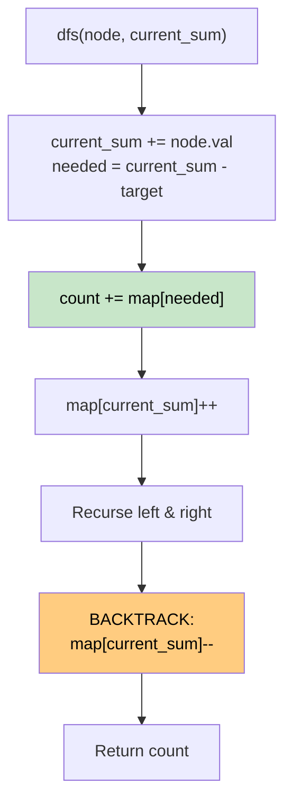

# 🚶‍♂️ Walkthrough: Path Sum III

## 👶 Explain Like I'm 5
You have a binary tree. Find the number of paths that sum to a given target. A path must go downwards from parent to child, but doesn't have to start at the root or end at a leaf.

This is exactly like finding subarray sums in a 1D array, but on a tree! We just use DFS to walk down the tree, maintaining a running prefix sum and a hash map.

## 🎯 Core Strategy
**Prefix Sum on a Tree + Hash Map (with Backtracking)**.

1. Use a hash map `prefix_counts` initialized with `{0: 1}`.
2. DFS down the tree. At each node:
   - `current_sum += node.val`.
   - Check if `current_sum - targetSum` is in the map. Add to total count if yes.
   - Add `current_sum` to map.
   - Recurse left and right children.
3. **CRITICAL STEP (Backtracking)**: After visiting both children, you are about to go back up the tree. You MUST remove the current node's `current_sum` from the map (decrement its count). Why? Because this prefix sum is only valid for paths going down *this* specific branch. It shouldn't be visible to parallel branches (e.g. from the right child of the root).

## 🏃‍♂️ Step-by-Step Execution (Dry Run)
**Tree**: `10 -> 5 -> 3`. Target = 8.
Init: `map = {0: 1}`, `count = 0`

| Node | current_sum | needed (sum-8) | count | Map Updates |
|---|---|---|---|---|
| 10 | 10 | 2 | 0 | `map[10] += 1` |
| 5 | 15 | 7 | 0 | `map[15] += 1` |
| 3 | 18 | 10 | `map` has 10 (count 1) → +1 | `map[18] += 1` |
| backtrack 3| - | - | - | `map[18] -= 1` |
| backtrack 5| - | - | - | `map[15] -= 1` |

Count = 1 ✅ (Path `5 -> 3`).

## 📊 Visual Diagram

## 🛑 Complexity
- **Time:** $O(N)$ — visit each node once.
- **Space:** $O(H)$ — recursion depth and map size bounded by tree height $H$.
